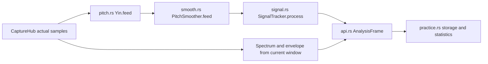
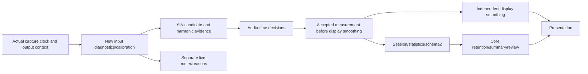

# Real-world input decisions, response and stopped-note retention

Status: **design proposal; not implemented or empirically tuned**. Baseline `c5670a1`, master; clean at design start. This change delivers behavior, starting parameters, interfaces and acceptance plans. It changes no runtime defaults and starts no goal. It extends the [practice workspace](practice-workspace.md); its previous verification report does not validate these new settings.

## 1. Goals and verified baseline

Q1 Ignore background noise, breath noise and bumps. Q2 Measure soft/loud playing and crescendos/decrescendos. Q3 Resist strong-harmonic octave errors without correcting real overblowing or wrong notes into the target. Q4 Preserve attacks, legato, glides and vibrato while allowing a calm pointer. Q5 Retain stopped-note results. Q6 Clearly separate retained/live/historical data and scores. Q7 Avoid exposing algorithm jargon. Q8 Share behavior across platforms with reproducible settings and recovery.

The graph does not index this repository; the following facts were checked directly in the baseline files, not inferred from another project's graph.

| Location / symbol | Current behavior | Proposed change |
|---|---|---|
| `core/src/pitch.rs:7–15`, `Yin::feed` | 2048 samples, CMNDF0.15, octave margin 0.05, clarity floor 0.6, default−45 dBFS; harmonic least-squares refinement | Candidate ambiguity and rejection diagnostics; retain periodic/harmonic evidence instead of selecting the largest FFT peak |
| `core/src/signal.rs:46`, `SignalTracker::process` | 3 dB gate hysteresis, two valid frames, immediate Holding after an invalid frame, indefinite retention | Audio-time confirmation; separate dropout/retained display from measurement validity |
| `core/src/smooth.rs:5–10`, `PitchSmoother::feed` | Five-frame median, Hz-domain EMA0.3 and two-frame note hysteresis | Time-based log-frequency display response, independently selectable |
| `core/src/api.rs:773`, `analyze_frame` | YIN → smoother → tracker; `TunarEvent.freq_hz` is already smoothed | Add a trustworthy measurement frequency before display smoothing; old files do not contain recoverable raw YIN frequencies |
| `core/src/api.rs:818`, `analyze_full` | Held pitch can coexist with spectra/envelopes from the new window | Retain an entire coherent measurement; show live input level separately |
| `core/src/practice.rs:359,508`, `point,observe` | Held/reference-contaminated frames excluded; full frames/configuration saved | Store decision provenance and policy version; display response must not change scores |
| Apple `SettingsStore.swift:34,56`, `SettingsView.swift:94`; Android `SettingsRepository.kt:32`, `SettingsScreen.kt:188` |−45 dBFS default,−60…−30 slider, no environment measurement flow | Plain-language controls with an advanced manual gate |

Current flow:



## 2. User controls

Three choices and one action. The target's ±2/5/10/20-cent accuracy tolerance remains independent.

| Control | Options / default | Meaning |
|---|---|---|
| Environment sensitivity | Soft / **General** / Noisy, or Manual | Soft admits lower margins; Noisy requires more separation from measured background, without promising operation in arbitrary noise |
| Response | Fast / **Balanced** / Steady | Pointer feel, not saved frequency or accuracy |
| Keep after stopping | Off /5 seconds /15 seconds /**Until next note** | Read the last result without implying that input remains valid |
| Measure background | “Do not play; stay quiet for 2 seconds”, with Cancel | Derive thresholds from this input/location instead of guessing dBFS |

No blocking calibration dialog on startup. Before calibration, use−45 dBFS and a small optional prompt. Diagnostics expose actual open/close thresholds, input level and the margin over background. These are digital levels and a background difference, not SPL, exact SNR or a probability of correctness.

Advanced settings initially expose only manual open threshold−80…−12 dBFS, hysteresis 3…12 dB and reset. Keep clarity, candidate scoring, FFT length and jump protection internal. Give practical advice: move closer or use Soft when input is weak; move farther away/reduce input gain when clipping. Do not make loud playing itself an error.

## 3. Initial policies

**Engineering starting points, not standards or validated production defaults.** Publish only after the acceptance matrix passes.

### 3.1 Background measurement

Start explicitly. Stop local reference/metronome output and wait for guarded tail frames; do not start without capture/permission. After successfully starting calibration, pause any recording; completion/cancellation does not automatically resume it. Mark calibration frames Calibrating and exclude them from scores while retaining an explicitly previous result. On the analysis queue, collect 2 seconds of RMS dBFS using actual audio positions and a fixed 128-slot buffer sampled at 20 Hz; let N be P80.

Fail within 5 seconds of audio time if valid contiguous coverage is insufficient, capture restarts/drops, or P95−P20 exceeds 12 dB. Failure/cancellation retains the previous result only in the same input context and marks it unrefreshed; a new device/generation still invalidates it. A persistent tonal component asks the user to confirm no playing occurred; retry or explicitly accept it as ambient. Do not claim to identify a fan, voice or instrument automatically. Save scalar results, never calibration PCM.

| Profile | Open T_on | Close T_off | Hysteresis |
|---|---|---|---|
| Soft | N+6 dB | N+3 dB |3 dB |
| General | N+10 dB | N+4 dB |6 dB |
| Noisy | N+14 dB | N+8 dB |6 dB |
| Manual / uncalibrated General | manual /−45 dBFS | open−hysteresis /−48 dBFS | default 3 dB |

Before calibration, Soft/General/Noisy fall back to−55/−58,−45/−48 and−35/−41 dBFS respectively, so profile changes take effect while clearly labeled uncalibrated.

For N=−60 dBFS, General opens at−50 and closes below−56. Supported open range is−80…−12 dBFS. If the result exceeds the upper bound, reject calibration with an actionable message instead of silently claiming success with a clamped threshold. Clamp below the lower bound to−80 and show the limitation; recompute close from the clamped open minus the profile hysteresis, not from the unclamped N.

Freeze thresholds during playing; do not learn a fading note as noise or raise the gate along with volume. The first version performs no continuous background learning. Invalidate on input/generation/rate changes, known input-gain changes or known system-processing changes. Undetectable gain/AGC changes require remeasurement; automatic detection is not guaranteed.

### 3.2 Timing and display

| Parameter | Starting value | Contract |
|---|---|---|
| Acquisition | 60 ms for every display response mode | Continuous qualified audio time; gaps reset confirmation |
| Display time constant τ |40 /80 /140 ms | Causal filtering in log frequency/cents, `alpha=1-exp(-dt/tau)` |
| Visible dropout grace |100 ms | Freeze pointer, label uncertainty; exclude the gap from its first frame |
| Admission/continuation clarity |0.85 /0.75 | Internal tentative thresholds, not correctness probabilities; validate with candidate rules, not by blindly relaxing YIN for breath noise |
| Ambiguous octave confirmation |80 ms; wait at most 120 ms | Only competing interpretations; unresolved ambiguity becomes invalid, never indefinite attachment to an old note |
| Automatic note-name boundary |5 cents beyond the nearest-note boundary for 60 ms | Stabilize the label only; never alter measured Hz/cents or a locked target |
| Stopped-note summary | Last 300 ms ending at the final trusted frame, at least 150 ms valid coverage | Median and P10–P90; insufficient coverage shows the last point with a short-note label |
| Clipping warning | At least 1% of samples with absolute amplitude≥0.98 | Exclude affected frames from scores/summary; do not infer clipping solely from RMS |

Use one confirmation chain instead of stacking delays at every layer. Reset display filters on a confirmed new note or renewed attack; do not synthesize a glide between separate notes. Preserve real vibrato/glides in accepted measurements. The 2048-sample window remains initially; low notes require enough periods. These settings are not end-to-end latency promises: measure first result, note change and settling separately against the existing latency goal. Unsupported lower ranges require a separate multiscale-window design.

## 4. Signal truth and presentation

Retain Quiet/Acquiring/Tracking/Holding, adding reason codes rather than a new main state for every problem. Presentation independently identifies Live/Held/Review. Review is immutable and ignores current sensitivity/response settings.

| Situation | Reading and plots | Live input | Measurement |
|---|---|---|---|
| No confirmed note | Waiting; optional subdued candidate, no in-tune success | Updates | Invalid frames may retain level/reason |
| Acquiring | Identifying; previous result labeled separately | Updates | Unconfirmed pitch excluded |
| Tracking | Trusted Hz/cents and coherent spectrum/envelope; pointer may be smoothed | Updates | Accepted frequency, not display EMA |
| Invalid interval≤100 ms | Frozen pointer with uncertainty label | Updates | Immediately break validity; never interpolate/fill scores |
| Invalid longer than 100 ms | “Last measurement”, with age; no live success animation/haptics | Separate, labeled live | No held duration added |
| Input/permission interrupted | Input interrupted; previous result remains inspectable | Unavailable | Pause/segment; explicit resume required |
| Reference/confirmed local click contamination | Output-affected label; professional monitoring remains available | Updates | Exclude known contaminated frames/tails; a running metronome is not continuous contamination |

### 4.1 Retained result

Keep the last trustworthy note/Hz/cents/spectrum/partials/envelope and its original target/A4 together. A historical-level value inside this card comes from that frame; a separate thin meter remains live. Never pair the old Hz with the current noise spectrum. Compute age only on a continuous valid capture clock; after interruption use “previous input”, not a frozen sample clock disguised as elapsed wall time.

Off disables temporary retained presentation without deleting session data. Timed expiry clears only that presentation. Until the next note is confirmed, retain an explicit “previous” card; confirmation atomically replaces it. Target/A4/temperament/instrument/input-context changes clear the main reading and move the retained card under previous conditions. Never recalculate an old result under a new target. Manual freeze/Review outranks automatic replacement; named snapshots remain independent.

Show the exact final trustworthy point as the main retained reading and a separate last 300 ms median/range summary if sufficient. Do not select the most in-tune point. Being wrong or varying is not itself invalidity; do not flatten true overblowing, vibrato or glides into the target.

### 4.2 Acoustic limitations

- Level is only one condition; periodicity, harmonic explanation and temporal evidence also matter. Speech/other instruments have pitches, and one microphone cannot reliably identify the performer. Suggest closer placement, less interference and a sensible instrument range.
- Extend existing YIN/harmonic refinement to retain up to 8 local-period candidates, evaluating period error, harmonic fit and continuity. Compute CMNDF once; apply expensive harmonic least-squares refinement to at most two competing candidates, and report added per-frame cost rather than using unbounded search. A broad playable range can constrain candidates; target proximity cannot determine the fundamental.
- A lone high partial may be indistinguishable from a genuine high pure tone. Do not divide by 2 merely because a lower target is locked. Persistent true octave changes must remain visible as +1200 cents.
- Breath-only attacks may have no reliable pitch: retain level/envelope until periodic evidence appears. Loudness cannot manufacture confidence or turn breathiness into a performance penalty.
- Do not stop a decaying string or decrescendo simply because level fell 10 dB. Periodic reverberation can outlive blowing; single-microphone measurements cannot determine exact breath duration. Label statistics “valid measurement time”, and allow manual selection to exclude tails.
- Practicing with a metronome must remain usable. Exclude continuous reference-tone/guarded-tail intervals; `metronome_active` indicates possible interference, not an invalid entire performance. For speaker clicks show a score-risk warning and recommend headphones. Exclude only reliably located contaminated click windows. The first version does not promise click echo removal; output/input-clock alignment and tail masking need separate physical-device evidence.
- Do not default to compression/AGC/aggressive denoising/echo cancellation for pointer stability. Record known unavoidable device processing and offer remeasurement without promising raw acoustic measurement.

## 5. Layout

Keep pitch and trace prominent. Near the reading, show Live/Uncertain/Last measurement/Input interrupted. Retained content uses a subdued but legible treatment; never rely on color alone or continue live success haptics.

The desktop inspector gets an Input and response group containing the three choices and background action, with manual numbers under Advanced. Narrow windows use the same details sheet; mobile opens a matching settings page without filling the home screen with sliders. The live meter marks background/open/close lines and explains weak input, clipping or unclear pitch. Not every failure should say “play louder”.

## 6. Proposed implementation contract

All decisions remain in Rust. Native code supplies capture/output context, permissions, local preferences/files and rendering. Keep callback rings preallocated and all new work on analysis/worker queues; do not add a second FFT.

New `core/src/input_policy.rs` defines the following proposed UniFFI enums/records (not exported yet):

```rust
GateMode = Auto | Manual
InputProfile = Soft | General | Noisy
ResponseMode = Fast | Balanced | Steady
HoldMode = Off | Seconds5 | Seconds15 | UntilNext
InputPolicy { gate_mode: GateMode=Auto, profile: InputProfile=General,
  manual_open_dbfs: f32=-45, manual_hysteresis_db: f32=3,
  response: ResponseMode=Balanced, hold: HoldMode=UntilNext }
InputReason = None | BelowGate | NoPeriodicPitch | AmbiguousPitch | Acquiring | Calibrating |
  Dropout | Clipped | OutputContaminated | InputUnavailable
InputDiagnostics { reason: InputReason, noise_floor_dbfs: Option<f32>,
  open_dbfs: f32, close_dbfs: f32, clarity: Option<f32>,
  clipped_fraction: f32, policy_revision: u32, calibration_revision: u32 }
CalibrationState = Idle | Measuring | NeedsQuietConfirmation | Ready | Failed
CalibrationStatus { state: CalibrationState, floor_dbfs: Option<f32>,
  elapsed_seconds: f64, reason: String }
```

Manual threshold/hysteresis must be finite and within the ranges above. Policy version 1 resolves other settings from the tables; decision/calibration revisions increment on effective changes and split measurement configuration segments. Response/hold are presentation-only: they neither split measurement segments nor alter acquisition/validity. Persist user choices, but retain environment estimates only in the current capture context. An existing legacy gate key migrates to Manual with its original value; new users start Auto with the uncalibrated fallback.

Proposed `TunarEngine` worker methods:

```rust
set_input_policy(policy: InputPolicy) -> Result<(), InputPolicyError>
begin_noise_calibration(output_active: bool) -> Result<(), InputPolicyError>
confirm_noise_environment() -> Result<(), InputPolicyError>
cancel_noise_calibration()
calibration_status() -> CalibrationStatus
analyze_input(pcm: Vec<f32>, context: InputFrameContext)
  -> Result<AnalysisFrame, InputPolicyError>
reset_input_context()
InputFrameContext { sample_position: u64, capture_generation: u64,
  reference_active: bool, metronome_active: bool }
```

Errors are InvalidPolicy/InvalidFrame/OutputActive/NoCalibration; asynchronous calibration failures appear in status. CaptureHub passes the real frame-end position before analysis, not by overwriting the timestamp afterward. Reject repeated/backward positions in one generation atomically; a gap over 1.5hop resets confirmation. Generation/input reset invalidates calibration and transient filters without deleting session history. The YIN energy pre-gate must use resolved T_off instead of the old fixed T_on−3 assumption. Legacy `analyze` builds a compatible context from accumulated hops; legacy `set_noise_gate` explicitly selects Manual, avoiding two competing gates.

`AnalysisFrame` gains optional `input_diagnostics` and `measured_freq_hz`: a qualified periodic/harmonic estimate before display smoothing, not PCM or an unqualified candidate. Legacy `tuner.freq_hz` retains display semantics. Add `PracticeSession::presentation() -> PracticePresentation` with source Live/Held/Review, optional coherent PracticePoint, optional `LiveInput { input_level_dbfs, diagnostics }`, optional held age and optional `NoteSummary { median_cents, low_cents, high_cents, valid_seconds }`. Bound storage to two full frame/configuration copies and a 300 ms scalar ring. A native view must not implement another retention timer.

Main numeric Hz/cents use one trusted measurement; the pointer uses display smoothing. Do not falsely claim raw numeric cents and a smoothed pointer are identical. Main tuner/instrument views use the same core presentation policy; explicitly live professional tools remain clearly labeled live.

JSON schema 2 stores decision-policy fields, resolved thresholds/revisions and measurement basis in configuration segments. Response/hold remain independent presentation preferences without changing historical measurements. Read schema 1 as `LegacySmoothed` without inventing lost raw frequencies or recomputing old scores. New schema 2 uses `AcceptedRaw`; preserve existing CSV columns and append measurement_basis/measured_freq_hz/display_freq_hz/quality_reason. New metadata counts toward the 32MiB budget and strict validation.

The exact baseline file/symbol/line map D1–D10 is in [Chinese §6](../input-behavior.md#6-实现合同与文件映射拟新增未导出). It covers input_policy/lib, pitch, signal/smooth, api, practice/codec, both CaptureHub/engine adapters/settings, both main tuner/instrument/workspace models/views, generated bindings and bilingual specifications. Existing published defaults stay unchanged by this proposal. Candidate-ranking weights must be compared on the fixed signal set rather than invented in the native UI;8 candidates does not mean full pYIN/offline Viterbi is adopted.

Proposed flow:



## 7. Construction and acceptance

- [x] Baseline, requirements, policies, state/layout, interfaces, file map and evidence boundaries designed.
- [x] Bilingual entry/milestone; documentation checks only, with no claim that application tests validate the new behavior.
- [ ] C1 Fix the candidate-ranking signal set; write D1–D5 implementation details and all test sources before running them.
- [ ] C2 Write all D6–D10 native/migration/wiring code and acceptance sources before execution.
- [ ] C3 After full implementation, run unified tests, parameter comparisons and physical-device acceptance; then adopt validated defaults in current specifications.

All A1–A12 are **unexecuted**. Unit/integration/E2E layers and exact-case timings reuse existing reporting; random seeds are fixed and logical time advances through samples.

| Acceptance | Inputs/actions | Required observations |
|---|---|---|
| A1/Q1 | Seeded broadband, fan/50/60 Hz hum, bumps and gate-boundary levels | No sustained false live-success display; no boundary flicker; report unresolved tonal interference rather than claiming zero false positives |
| A2/Q2 | Fade from above open through close,44.1/48 kHz and 512/1024hop | Audio-time hysteresis, no fabricated gap scores/threshold chasing; timing difference≤one hop |
| A3/Q3 | H2/H3 above fundamental by 12 dB, missing fundamental with H2/H3, lone high tone, real 220/440/880 Hz overblowing | Supported fundamental remains correct; real octaves pass without folding; no target-induced divide-by 2 |
| A4/Q3/Q4 | One-frame octave errors, persistent jumps, semitone legato and scales | Reject short ambiguity without sticking indefinitely; initial end-to-end Balanced targets≤150 ms first result and≤200 ms real note change, to validate before publication |
| A5/Q4 |5 Hz±20c vibrato,300c/s glide,+3/−7c notes, three response modes | Accepted traces retain variation; saved frequencies/statistics equal across display modes while pointers differ |
| A6/Q5 | All hold modes, next note and manual Review | Explicit origin/age; no held valid seconds; atomic replacement; Review not displaced; expiry never deletes files |
| A7/Q6 | Stop, then introduce other noise while inspecting all panels | Retained numbers/plots share one original frame/configuration; separate live meter changes |
| A8/Q6 | Off-target/varying/short notes, breath attacks, reverberation and string decay | No cherry-picking; insufficient summaries labeled; invalid/held/acquiring/contaminated data excluded; valid measurement time is not breath duration |
| A9/Q7 | Calibration disturbed/canceled/interrupted/without permission, legacy gate migration | Same-context old result preserved on failure; tonal confirmation; no PCM; legacy Manual retained; no algorithm expertise required |
| A10/Q8 | schema 1/2 round trips, invalid/unknown data and 32MiB edges | Legacy source labeled with unchanged values; new policy/source reproducible; atomic rejection |
| A11/Q8 | Reference output, speaker/headphone metronome, feedback, clipping and device changes | Exclude reference/known contamination, not the whole metronome performance; show uncertainty when click timing is unknown; diagnose clipping/input loss and contextual calibration invalidation |
| A12/Q7/Q8 | Physical soft/normal/noisy playing, wide/narrow desktop, themes/text/motion | Usable controls/status; applicable 80–1500 Hz instruments; report noise level, false positives/negatives and latency separately |

## 8. Technical basis

[aubio's official pitch interface](https://aubio.org/doc/latest/pitch_8h_source.html) separates silence, YIN tolerance and confidence, supporting separate policy layers rather than one magic sensitivity number. The [pYIN paper](https://webspace.eecs.qmul.ac.uk/s.e.dixon/pub/2014/MauchDixon-PYIN-ICASSP2014.pdf) explains why smoothing a single discarded-candidate output can lose the correct interpretation; it supports retaining candidate evidence, not adoption of its code/decoder. [Aalto's fundamental-frequency material](https://speechprocessingbook.aalto.fi/representations/fundamental-frequency-f 0/) explains harmonics and missing fundamentals, supporting avoidance of largest-peak pitch selection.

These sources support mechanisms, not this product's optimal parameter values, real-device performance or arbitrary-noise separation guarantees.
