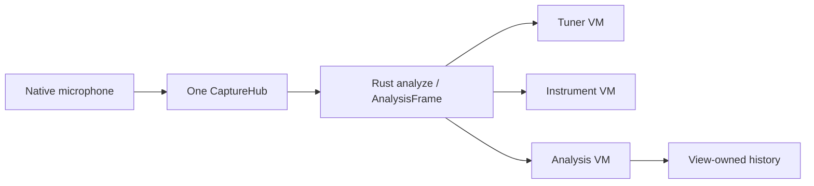
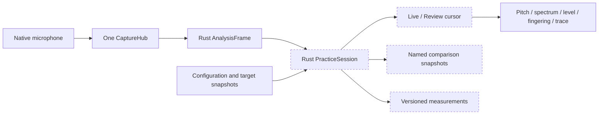

# Practice, measurement review, and the desktop workspace

Status: **design proposal; not implemented or runtime-accepted**. This change adds design only;
it does not change the app, the UniFFI contract, or implemented behavior in existing specifications.
Before implementation, complete the file-by-file construction plan and all tests. The current
professional view still follows the non-goals in `spec-ui.md` §3; do not expose unfinished save,
review, or export controls.

## 1. User tasks and priorities

Organize information around three tasks:

- **Tune**: identify the note, direction, and size of the deviation at a glance.
- **Practice**: choose a target, play a sustained note, then inspect onset, body, ending, and level.
- **Analyze**: compare spectra and measured partials across registers, fingerings, or conditions.

P1: locked targets, cents traces, measurement review, and desktop layout. P2: reference snapshots,
selection statistics, local saving, and export. P3: fingering variants, interval-ratio guides, and
reference-tone timbres. These are product priorities, not implementation or acceptance batches in
this change. A recording studio, accompaniment player, score editor, and instrument-making
simulator are outside scope.

## 2. Current source snapshot and differences

Baseline commit: `fa20d55`. These are source observations, not current device verification. Graph
tools were unavailable, so exact files and symbols were read directly; this is not an exhaustive
repository audit.

| Existing location / symbol | Current responsibility | Proposed difference |
|---|---|---|
| `core/src/api.rs:336`, `AnalysisFrame` | Pitch, spectra, envelope, sample position, signal state | Reuse the frame; add sessions and immutable configuration snapshots |
| `core/src/api.rs:817`, `analyze_full` | One analysis supplies the views | Add a recording consumer, not another FFT |
| `ios/Tunar/Tuner/SpectrumHistory.swift:4`, `SpectrumHistoryBuffer` | View history, peak hold, freezing | Keep it as a presentation cache, not persistent measurement storage |
| `acceptPitch` in that file | Approximately 12 seconds of MIDI trace; callers pass integer `midi` | Compute cents from trusted full-precision `freq_hz`, not integer note numbers |
| `ios/Tunar/Instrument/InstrumentViewModel.swift:521`, `updateWindTarget` | Deviation from the nearest chart note | Separate fingering preview from target locking |
| `android/app/src/main/kotlin/com/liuchong/tunar/ui/instrument/InstrumentViewModel.kt:520`, `applyWindReading` | Nearest-note highlights for main/detail charts | Share target rules in core |
| `macos/TunarMac/App/DesktopRootView.swift:3`, `DesktopRootView` | Six sidebar sections; detail identity follows selection | Own the session at window scope across navigation |
| `macos/TunarMac/Views/DesktopAnalysisView.swift:14` | View-owned history; metrics from the live VM | Resolve every review panel from one selected historical frame |
| `core/src/reference.rs:26`, `list` | Reference tones for the current A4 and equal temperament | Keep current behavior; extend timbres and interval guides separately |

Current flow:



Proposed flow; dashed nodes are additions:



## 3. Preview, detection, and locked targets

Keep `preview_fingering_id`, `detected_pitch`, and `target` independent. Existing chart taps still
preview a diagram; an explicit **Set practice target** action locks tuning. Never silently change
all previews into locks. When locked, show the target diagram and a separate detected-note marker.

- `Auto`: find the nearest step in the selected temperament, visibly labeled automatic.
- `Locked`: select a core reference/instrument tone; show a lock, target label, Hz, and unlock action.
- Compute `1200 * log2(measured_hz / target_hz)` without nearest-semitone or octave folding.
  Clamp only the needle at the scale edge, with a direction arrow; preserve the actual numeric error.
- Default practice scale: ±50 cents; optional ±100. Tolerance is independent: 2/5/10/20 cents,
  default ±5. Snapshot tolerance for statistics; changing it must not rewrite historical results.
- For non-12 equal temperaments, use the selected step and Hz rather than forcing a 12-TET name.
- A4, temperament, target, or instrument changes create a configuration segment. Historical data
  uses its original configuration, not current settings.
- Quiet, Acquiring, and Holding create no valid practice point. A retained reading may remain on
  the dial, labeled held, but does not count toward duration, accuracy, or stability.

## 4. Measurement sessions and review

### 4.1 State and controls

Recording state: `Idle / Recording / Paused / Complete`. Display state: `Live / Review`.
**Record measurements** starts an explicit session. **Pause recording** stops appending but leaves
existing microphone capture active. **Stop recording** completes and retains the session. Freeze
view, pause recording, and stop microphone capture are distinct commands with distinct labels.

Scrubbing enters Review and pauses recording so data cannot be overwritten during inspection.
**Return to live** only exits Review; recording resumes only through an explicit command. Preserve
session/cursor across tune, instruments, and analysis. Entering metronome, tools, or settings pauses
recording and releases the practice capture reference; returning requires explicit resume, without
hidden capture. Window inactivity, system interruption, or device reconstruction pauses recording,
stops reference tones, and ends the capture segment. Resuming starts a new segment.

- Desktop: Space pauses/resumes recording; arrows step one point; Shift+arrow steps one second.
  Do not intercept keys belonging to text inputs, dialogs, or system shortcuts.
- Touch: scrub, previous/next point, and return to live; targets at least 48dp/pt.
- Clear measurements and reset peak hold remain distinct. Clearing must disclose its scope and
  must not delete named snapshots or saved files.

### 4.2 Data, time, and capacity

Measurements are not audio recordings. Do not store raw PCM or offer audible playback. Each point
retains one `AnalysisFrame`: sample position/rate, state, held flag, trusted frequency, clarity,
input dBFS, target/configuration IDs, 64/128 spectrum bins and axis bounds, 256-column waveform
envelope, actual partials, and chord. Missing measurements retain nulls and reasons.

Keep at most ten complete frames per second, bucketed by audio sample time, retaining actual
timestamps rather than manufacturing regular ones. Stop at ten minutes, 6000 points, or 32MiB of
serialized payload, whichever occurs first; pause and explain without silently overwriting data.
704 float32 array values × 6000 points is approximately 16.1MiB before metadata: this is a budget
estimate, not a measured process-memory claim. Bound/preallocate storage and page across FFI;
never copy the entire session every frame. Measure actual peak memory during implementation.

Engine restarts may reset `sample_position`. Use `capture_generation` and `segment_id`; derive
within-segment time from position/rate. Preserve an explicit interruption between segments.
Mark configuration changes, dropped frames, pauses, and reference-tone transitions; selections
cannot blindly treat these events as one uninterrupted target.

In Review, note, Hz, cents, level, fingering, spectrum, and partials come from **one selected point**.
Show **Review 00:12.4**. If live input is also visible, label it **Current input** separately.

### 4.3 Save and export

P2 uses versioned UTF-8 JSON containing schema_version, configuration segments, original points,
snapshots, and selections, without audio. Rust owns parsing/validation; native shells own file
pickers and atomic writes. Reject unknown versions, truncation, non-finite values, oversized arrays,
or invalid references without damaging the current session or guessing repairs.

CSV exports the session or selection with segment_id, time_seconds, state, is_held, freq_hz,
target_hz, cents, input_dbfs, clarity, config_id, and reference_tone_active. Missing values are empty,
not zero. Escape formula-leading free text. JSON supports complete reopening; CSV is analytical
output and cannot reconstruct spectra.

## 5. Sustained notes and selection statistics

Use full-precision Hz for cents against the explicit target. Default to the latest 12 seconds,
zoomable to the full session. Label seconds/cents and keep zero/tolerance visible. Break the trace
at Quiet, Acquiring, Holding, and segment changes. A held needle must not become a sustained note.
Show level with its own dBFS axis or aligned subplot, never on the cents axis.

For a selection within one target/configuration segment, Rust returns valid covered duration,
median cents, P10–P90 spread, time inside tolerance, and valid-data coverage. Weight by audio time,
not frame count. Only spans between adjacent trusted points no more than 0.25 seconds apart are
valid; invalid points break spans. Do not fill pauses/gaps. Interpolate tolerance crossings linearly
to calculate in-tune duration. Accuracy divides by valid duration; coverage divides by selection
duration. Display both, so missing data cannot hide behind a high accuracy result. Use the same
time weights for the median and percentiles.

Require at least one valid second and five trusted points; otherwise report insufficient data.
Split selections across target/configuration changes rather than combining their cents medians.
Do not automatically discard onset/ending or label intentional vibrato as a technical error.
Mark reference-tone playback and exclude it from performance statistics by default, preventing
speaker-to-microphone leakage from becoming a successful practice result.

## 6. Spectrum and waveform comparison

P2 stores up to eight named snapshots from trusted live frames or review points. **Use as reference**
selects one overlay. Distinguish current/reference with line styles and labels, with hide/show.
Peak hold remains a per-bin maximum and is not a reproducible single performance snapshot.

- Default to absolute dBFS; optional **Normalize to peak** explicitly removes overall level differences.
- Record instrument, target, A4, sample rate, FFT/bin-axis definition, frequency bounds, input-condition
  notes, and timestamp. Mark different conditions; reject incompatible grids rather than silently resampling.
- Compare actual measured partial Hz, amplitude, and Hn. Missing partials remain absent. A 64/128-bin
  display does not establish raw FFT peak resolution; cursor interpolation adds no measurement precision.
- Waveforms are min/max envelopes, not phase-aligned PCM. Compare side by side without evidence of
  alignment. Do not infer instrument quality from different microphones, distances, gains, or envelopes.

P3 may add linear frequency axes, local ranges, and interval-ratio guides. The first two require
core to derive new presentation data from the original linear FFT bins in the same transform;
relabeling logarithmic bins is invalid. Ratio guides require an explicit root and ratio set and
must not be advertised as a complete temperament. Visible, reversible noise-band exclusion remains
an advanced experiment until false-negative/octave-error evidence exists; never silently remove
the target fundamental.

## 7. Desktop layout and hierarchy

Keep the six sidebar sections. Tune and instruments enter different contexts of one window-owned
measurement workspace. Its task switcher is **Tune / Practice / Analyze**; the existing analysis
sidebar selects Analyze. Navigation does not create another session, audio pipeline, or window.
Metronome, tools, and settings remain separate tasks.

| Task | Dominant region | Always available | On demand |
|---|---|---|---|
| Tune | One needle, large note, signed cents | Auto/lock, target Hz, held state, input level | Spectrum, detailed fingering, session |
| Practice | Pitch readout and target-cents trace | Target fingering, recording state, timeline, reference toggle | Selection statistics, full chart, spectrum |
| Analyze | Spectrum/waveform comparison | Cursor values, current/reference, range, state | Waterfall and full peak table |

Wide practice layout, schematic rather than an application screenshot:

```text
┌─────────┬─────────────────────────────────────────────────┐
│ Sidebar │ Task switch    G xiao / 8 holes   A4=440  12-TET │
│         ├──────────────────────────────┬──────────────────┤
│ Tune    │ G4   +3.2 cents              │ G4 · Locked      │
│ Instr.  │ One needle / Sharp / Hz      │ Whole instrument │
│ Analyze │                              │ Target fingering │
│ …       ├──────────────────────────────┤ Preview ≠ lock   │
│         │ Target-cents trace + level   │ Reference on/off │
│         ├──────────────────────────────┴──────────────────┤
│         │ Recording state · Pause · Timeline · Live       │
└─────────┴─────────────────────────────────────────────────┘
```

- Use content width: ≥1040pt has a main region and 280–320pt inspector. At 720–1039pt collapse the
  inspector into a target row and open full fingering in a drawer. Below 720pt, stack pitch,
  recording, and trace; collapse the spectrum.
- Below 760pt height, compress decorative dial/header space without hiding readouts or recording
  controls. Resize preserves the session. The sidebar remains collapsible; breakpoints use content
  width, not total window width.
- Remove the fixed 570pt assumption from the desktop tuning composition. Prioritize a 64–88pt note,
  28–36pt cents, and nonoverlapping needle/readouts. Keep the instrument whole; open the full chart
  in a drawer instead of squeezing it into every task.
- Pitch dominates Tune; the trace is second in Practice; the spectrum dominates Analyze. Do not
  permanently expose waterfall, peak table, chord, waveform, and full fingering together.
- Keep A4, target, and tolerance near the readout; less frequent controls belong in the inspector.
  Retain Aurora semantics, one needle, tabular digits, and reduced-motion preferences. Show dBFS;
  label low input/clipping explicitly without claiming uncalibrated sound-pressure levels.
- Mobile shares sessions and rules while preserving the current main layout. Review gets a full-screen
  page; comparison and statistics use a drawer.

## 8. Fingering and reference-tone extensions

P3 separates actual pitch from fingering variants: family, size/key, hole system, school, register,
traditional note name, holes, embouchure guidance, and alternate variants. Offer school choices only
with reliable data, with no single-option picker. Never invent missing fingerings by renaming or
octave-shifting patterns. Detected pitch does not prove which physical fingering was used.

Consider independent reference volume and sine/soft-harmonic timbres. Rust owns pitch tables and
waveform sample generation; native shells play samples. Preserve the current default; verify smooth
switches, output failure, playback markers, interruption stops, and speaker leakage exclusion.

## 9. Proposed modules and boundaries

These are **proposed additions, not exported APIs**. Update `spec-core.md` and generated bindings
when implementing.

| Module / type | Proposed responsibility / entry points |
|---|---|
| `core/src/practice.rs`, `PracticeSession` | Target resolution, state machine, bounded storage, statistics; `set_target`, `start`, `pause`, `finish`, `append`, `read_page`, `summarize` |
| `core/src/measurement_file.rs` | JSON/CSV codec, version/capacity validation, no platform file APIs |
| `MeasurementPoint` | `id: u64`, `segment_id: u32`, `config_id: u32`, `sample_position: u64`, `sample_rate_hz: f64`, `frame: AnalysisFrame`, `target_hz: Option<f64>`, `reference_tone_active: bool` |
| `PracticeConfigSnapshot` | Immutable A4, temperament, target mode/step/Hz, instrument/model/variant, tolerance, capture generation, axis definition |
| `MeasurementSnapshot` | Independent frame/configuration copy that survives session clearing; never a ring-buffer pointer |
| Apple window-scoped `PracticeWorkspaceModel` | UniFFI-only core access; session handle, display cursor, layout, file dialogs; one injected instance |
| Android `PracticeWorkspaceViewModel` | One session in navigation scope; shared capture stream; native permissions/lifecycle |

Add the two core modules and exports; add shared Apple/Android workspace models and panels;
inject one workspace in macOS `DesktopRootView`. Keep short-term presentation caches separate from
measurement/statistics truth. Audio callbacks still only write to a preallocated ring. Append,
encoding, statistics, and FFI pagination run on analysis/worker threads, not audio callbacks.

## 10. Design delivery, implementation, and acceptance

Design delivery:

- [x] Source snapshot, workflow differences, task layout, and state boundaries.
- [x] Data/memory limits, save semantics, ownership, and observable acceptance criteria.
- [x] Bilingual design entry and future milestones.

Implementation, not performed in this change:

- [ ] I1 Complete exact signatures, file-by-file construction snippets, and all tests before implementation.
- [ ] I2 Core targets, sessions, statistics, snapshots, versioned files, and UniFFI.
- [ ] I3 Three-platform session wiring, desktop task layout, and mobile review.
- [ ] I4 Separately scoped fingering variants and reference-timbre extensions.

Acceptance, not executed in this change:

- [ ] A1 Lock D4; drift to D#4 and D5 without target jumps or folded errors; indicate off-scale needles.
- [ ] A2 Distinguish synthetic +3/-7 cents on the same note; silence/Holding creates breaks.
- [ ] A3 Preserve session/cursor/snapshots across tasks/sidebar with one capture and one FFT.
- [ ] A4 Verify keyboard/touch stepping, focus handling, and no implicit recording resume.
- [ ] A5 All review values refer to one frame; current settings never change historical targets/A4.
- [ ] A6 Restarts, sample-rate changes, interruptions, inactivity, pauses, and drops produce segments/gaps.
- [ ] A7 Each capacity limit pauses append and retains results; measure bounded storage/paging/encoding memory.
- [ ] A8 Verify time-weighted accuracy/coverage, invalid samples, reference tones, cross-target selections,
  and insufficient-data states.
- [ ] A9 Reopen snapshots; clearing peaks/session retains the reference; mark different conditions and reject
  incompatible grids.
- [ ] A10 JSON round-trip equivalence, CSV nulls, and safe rejection of truncated/unknown/oversized/invalid data.
- [ ] A11 Verify content widths 640/900/1200pt and heights 600/800pt, light/dark, large text, and reduced motion;
  no note/needle overlap, complete target diagram, visible recording controls; native screenshots required.
- [ ] A12 Exclude reference leakage from scores; verify denied permissions, failed input/file writes, and resume.

Only the design delivery is complete. Implementation and runtime acceptance remain independent,
unchecked states. This document starts no automatic goal.
