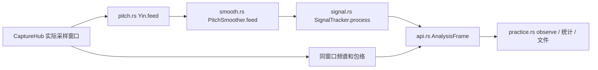
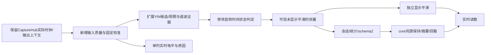

# 真实环境下的输入判定、响应与断音保持设计

状态：**设计提案，未实现、未调参验收**。基线 `c5670a1`，master；设计开始时工作区干净。
本轮只交付产品行为、初始参数、接口边界与验收计划，不改变已发布行为，不启动 goal。
这是[练音工作区](practice-workspace.md)的后续设计；原验收报告不证明本文新参数有效。

## 1. 用户目标与当前差异

Q1 背景噪声、气声、碰击不应让音名和指针乱跳。Q2 轻吹、强吹、渐强渐弱均可测。
Q3 强泛音不应轻易造成八度误判，也不能把真实超吹或吹错音自动纠正成目标音。
Q4 起音、连音、滑音、颤音应保留；指针可以平稳，测量不能被“美化”。
Q5 停吹后可读完结果；Q6 历史、保持、实时输入及成绩的含义明确。
Q7 非专业用户无需理解一排算法参数；Q8 三端同源、配置可追溯、可恢复。

以下为当前源码事实，图谱未索引本仓库，按表内文件直接查读；不作全仓库穷尽结论。

| 基线位置 / 符号 | 已有行为 | 本设计补足 |
|---|---|---|
| `core/src/pitch.rs:7–15` / `Yin::feed` | 2048窗，CMNDF 0.15，八度裕量0.05，clarity下限0.6，默认门限−45dBFS；周期选择后做谐波最小二乘精化 | 保留周期/谐波依据，增加拒绝原因和候选歧义；不把最大频谱峰直接当基音 |
| `core/src/signal.rs:46` / `SignalTracker::process` | 开关门限相差3dB，连续两帧确认，Tracking一帧无效即Holding；无限保留音高 | 改为音频时间确认；短缺口、重新起音、保持显示与测量有效性分离 |
| `core/src/smooth.rs:5–10` / `PitchSmoother::feed` | 5帧中值、Hz域EMA α=0.3、音符两帧滞回 | 可解释的响应档；在log频率域按时间平滑，仅作用于显示 |
| `core/src/api.rs:773` / `analyze_frame` | YIN→平滑→SignalTracker；`TunarEvent.freq_hz`已经平滑 | 新增可信未显示平滑的测量频率；不能把现有文件的频率说成原始YIN频率 |
| `core/src/api.rs:818` / `analyze_full` | Holding时音高可来自旧输入，频谱/包络仍来自当前窗口 | 工作区保持整份同源测量；实时电平另列，禁止旧Hz配新频谱冒充同一时刻 |
| `core/src/practice.rs:359,508` / `point,observe` | Holding/参考输出不计有效点；保存完整帧、目标及配置 | 保存判定参数版本、拒绝原因及测量来源，隔离显示响应对成绩的影响 |
| Apple `SettingsStore.swift:34,56` / `SettingsView.swift:94`；Android `SettingsRepository.kt:32` / `SettingsScreen.kt:188` | 默认−45dBFS，用户滑动−60…−30；没有环境校准流程 | 普通设置用自然语言；高级页保留手动门限 |

当前调用：



## 2. 普通用户看到什么

设置分成三项和一个动作；各项互不替代。目标准音容差仍是±2/5/10/20 cents，单独保留。

| UI文案 | 选择 / 默认 | 解决的问题 |
|---|---|---|
| 环境适应 | 轻声 / **通用** / 较吵；也可切手动 | 轻声更容易接入；较吵需要更明显高于背景，不能承诺任意噪声下可用 |
| 响应速度 | 迅速 / **均衡** / 平稳 | 连音/滑音偏迅速；调长音偏平稳；不改变存档频率或准音率 |
| 停吹后保留 | 关闭 / 5秒 / 15秒 / **直到下次发声** | 保留结果便于观察；不是继续测到了声音 |
| 测一下环境噪声 | 点击后提示“先不要演奏，保持2秒安静”，可取消 | 按当前位置自动算门限；不要求用户猜dBFS |

默认不弹校准拦截框；未校准时以−45dBFS工作，显示“可测一下环境，改善轻声识别”。
手动值与自动结果都展示实际开启/关闭门限、电平和“高于背景多少dB”，供排查使用。
这些是数字输入电平和相对背景差值，不是声压级，也不是精确SNR或识别概率。

高级页仅开放手动开启门限（−80…−12dBFS）、门限差（3…12dB）、恢复默认。
clarity、候选评分、FFT窗、跳变保护等由core策略控制，第一版不暴露独立旋钮。
“不够灵敏”提示靠近麦克风或试轻声档；“输入过强”提示退远/降低输入增益，不要求吹得更轻才算合格。

## 3. 按环境定门限与初始参数

**下表为工程起点，不是行业标准或已经验证的最佳值。** 实测矩阵通过前不得提升为默认发布合同。

### 3.1 环境测量

用户主动启动；参考音/节拍器在本机发声时先停止输出并等待保护尾帧结束，采集权限或设备不可用则不开始。
成功开始校准时暂停已有记录，完成/取消不自动继续；校准帧标Calibrating且不计成绩，旧结果标“上次”。
core在分析队列按实际采样位置收集2秒RMS dBFS（固定128槽，20Hz等时采样），取P80为背景值N。
最多等待5秒音频时间；连续有效覆盖不足2秒、设备重启、丢窗或P95−P20>12dB时失败，同一输入上下文保留上次可用结果并注明未更新，提示重测；换设备/代次仍须失效回退。
检测到持续明显音调时提示“请确认没有演奏”；用户可重测，或确认它确为环境声后采用，不能自动声称辨认出了人声/风扇/乐器。
不保存校准PCM；只保存本次采集上下文中的标量结果。

| 档位 | 开启T_on | 关闭T_off | 差值 |
|---|---|---|---|
| 轻声 | N+6dB | N+3dB | 3dB |
| 通用 | N+10dB | N+4dB | 6dB |
| 较吵 | N+14dB | N+8dB | 6dB |
| 手动 / 通用未校准回退 | 手动值 / −45dBFS | T_on−门限差 / −48dBFS | 默认3dB |

未校准的轻声/通用/较吵分别以−55/−58、−45/−48、−35/−41dBFS回退，使选择档位立即有可解释效果；界面仍注明“尚未按环境测量”。
例如背景−60dBFS，通用档为−50/−56dBFS：超过−50才能开始，已开始后下降到−56以下才失去有效输入。
T_on支持−80…−12dBFS；超出上界不悄悄截断成一个看似成功的校准，提示环境太响/输入增益不合适并保留旧配置；低于下界取−80并显示受下界限制，再按该档差值重算关闭门限，不能夹紧开启值后仍用未夹紧的N计算关闭值。
同次演奏期间门限固定，不追着音量上涨，也不把渐弱长音学习成噪声。第一版不自动连续学习背景。
换输入设备、实际采样率/采集代次、输入增益或已知系统处理模式改变后，校准失效并回退；无法检测的增益/AGC变化由用户重测，不能承诺自动发现。

### 3.2 时间、可信度与显示

| 参数 | 初始建议 | 含义 |
|---|---|---|
| 新发声确认 | 统一60ms，不随显示响应档变化 | 从首个合格候选累计连续音频时间，不能按UI帧数计；采集缺口重置计时 |
| 显示平滑时间常数τ | 40 / 80 / 140ms | `α=1−exp(−Δt/τ)`；在log频率/cents域做因果滤波 |
| 短缺口显示缓冲 | 100ms | 暂停指针更新，显示“信号不稳”；缺口从第一帧起就不算有效测量，不插值补成绩 |
| 接入/维持clarity | 0.85 / 0.75 | 暂定内部门限；clarity不是正确概率，需与周期候选规则联合验证，不能单独放宽YIN以接收气声 |
| 明显八度歧义保护 | 80ms确认，最长120ms等待 | 只在候选竞争时启用；到时仍歧义则标无可信音高，不能永远黏住旧音 |
| 自动音名边界滞回 | 跨过最近音分界额外5c，持续60ms | 只稳定音名标签；不改实际Hz、音分或锁定目标 |
| 停吹摘要窗口 | 最近300ms可信点，至少150ms有效覆盖 | 显示中位音分与P10–P90；不足则显示最后可信点并标“短音，未形成摘要” |
| 削波告警 | 峰值绝对值≥0.98的样本占比≥1% | 标“输入过强”，这些帧不作成绩/停吹摘要；不是据RMS猜削波 |

确认与音符切换使用同一判定链，避免层层叠加重复等待。新音符确认或断音重起后重置显示滤波，
不能把前一个音缓慢滑成下一个音；同一音的真实颤音和滑音仍保留在未显示平滑的测量轨迹中。
低音必须具备足够周期的窗口；第一版先保留2048窗，不能宣称上述时间等于全链路延迟。
验收分别测首读数、换音和显示收敛，兼顾当前音频延迟目标；低于当前有效频域的乐器需另设计多尺度窗。

## 4. 信号与显示分开管理

信号状态沿用Quiet / Acquiring / Tracking / Holding；增加原因枚举，而非把每种异常堆成一个新主状态。
显示来源独立为Live / Held / Review。Review始终读取不可变文件/会话点，不受当前环境设置影响。

| 情形 | 主读数 / 图表 | 实时电平 | 记录与统计 |
|---|---|---|---|
| 从未确认声音 | “等待声音”；可显示灰色候选，不标为准音绿 | 继续更新 | 无效点仍可记录输入电平和原因 |
| 起音确认中 | “正在识别”；旧保持结果可并列但须标“上次” | 继续更新 | 未确认频率不计准音率 |
| 正常Tracking | 可信Hz/真实音分、同一窗口频谱/包络；指针用显示平滑值 | 继续更新 | 记录可信频率；不使用显示EMA作成绩 |
| 短暂失效≤100ms | 指针不追噪声，标“信号不稳” | 继续更新 | 立即断开有效区间；不填零、也不把旧值复制成新有效点 |
| 失效超过100ms / 停吹 | 进入Held外观，“上次测量 · 距今…”；不显示正在准音的动效/触觉 | 明确标“实时输入”，独立更新 | 记录无效原因，保持帧不增加持续时间 |
| 设备/权限中断 | “输入已中断”，旧结果可查看；不伪装正常静音 | “不可用” | 暂停会话，设备/代次分段；恢复仍需显式继续 |
| 参考输出 / 已确认的本机节拍污染 | 提示“输出影响中”；保留专业工具的实时监听用途 | 继续更新 | 已知污染不计成绩，保留标记与输出尾保护；节拍器仅在运行不等于整段污染 |

### 4.1 停吹后保留的内容

默认一直保留最近一次可信测量的**同一份**音名、Hz、真实音分、频谱、泛音、包络及其目标/A4。
图表标原始时间；“距今”仅在连续有效的同一采集时钟内计算，输入中断改标“上次输入”，不把暂停的采样时钟冒充墙钟；电平若与该历史帧放在同一卡片中也用历史值，另设细条显示实时输入。
不拿上一音的Hz配现在的噪声谱。用户选关闭则停止保持展示，已记录数据与快照不删除。
定时保留仅清掉临时展示，到期不清测量文件。下一音确认前保留“上次”；确认后一次性替换整份结果。
换目标、A4、律制、乐器或输入上下文时，旧保持卡移入“上次条件”并清空主读数，不以新目标重算旧结果。
用户手动冻结 / Review优先级更高，不能被下一次发声抢走；命名快照仍独立。

“最后一帧”和“这次长音的代表值”分开：主保持卡如实显示最后可信点，旁边可显示以最后可信点为窗口末端的300ms摘要及波动范围，
不偷偷挑最接近目标的点。准或不准都能形成摘要；不能用接近目标作为可信度条件。
超吹、真实八度跳转、演奏颤音可能是用户要观察的结果，不能抹平或强制吸附目标。

### 4.2 噪声、共振、气声与余响

- 音量足够只是必要条件之一；还要有足够的周期性、谐波解释及时间一致性。说话/旁人乐器本身可能有音高，单麦克风不能保证区分是谁在演奏；建议更近收音、减少干扰、选择合理音区。
- 保留现有YIN和谐波精化，候选选择可保留最多8个局部周期候选，联合周期误差、谐波拟合和短时延续评估。CMNDF只计算一次，昂贵的谐波最小二乘精化最多作用于两个竞争候选；新增耗时须逐帧报告，不用无界候选搜索换准确率。沿用实际乐器可演奏范围作为宽约束，不以“离锁定目标最近”决定基音。
- 遇到只有一个高次分音的输入，物理上可能与真正高八度的纯音相同；不能保证还原不存在的基音。持续证据支持真实高音时应显示+1200c，而非除以2让结果看起来准。
- 起音气声可能没有可靠音高：保留电平/波形，待有周期性后再给Hz。气声多不等于演奏差，也不能因音量大就授予高可信度。
- 音量缓慢下降不直接判停：弦乐衰减是正常声音，管乐渐弱也应保留。持续混响仍有周期性时，单麦克风无法准确知道人何时停吹；统计明确称“有效测量时间”，不是精确呼气时长。可用手动选区排除尾响，不以统一下降10dB规则裁掉所有乐器尾音。
- 跟节拍器练习应可用。连续参考音的活动/尾保护区间排除成绩；`metronome_active`只表示潜在风险，不能因节拍器开着就把整段演奏作废。扬声器跟拍提示“成绩可能受节拍声影响，建议耳机”；只有可信定位的点击污染窗才排除。第一版不承诺已消除节拍回声，精确输出/输入时钟对齐及尾响屏蔽必须单列实机验收。
- 第一版不默认加音频压缩、AGC、强降噪或回声消除来“稳定指针”；如设备强制启用则记录已知处理条件，提供重测提示，不承诺原始声学测量。

## 5. 桌面与移动布局

沿用音准与轨迹优先的布局。主读数附近仅新增状态文字（实时 / 信号不稳 / 上次测量 / 输入中断），
历史读数使用较弱背景并保留可读对比度；不能单靠颜色区分。停止准音庆祝与触觉，保持数字可读。
桌面目标检查器增加“输入与响应”分组，普通三项和“测一下环境”按钮放这里，详细门限收在高级折叠。
窄窗同组进详情抽屉；手机从工作区进入同一设置页，不在现有首页堆满滑块。
实时电平条标背景线、开门线、关门线；文字可解释“当前低于开启值”“输入过强”“音高不明确”。
显示丢帧、音调不明和权限失败的提示不能都写成“请大声一点”。

```text
A4   −7.2 cents       上次测量 · 1.3秒前
440Hz目标 / A4=440    停吹前300ms：中位−6.8c，波动−9…−4c
[ 同一测量的频谱 / 轨迹；不再冒充正在实时更新 ]
实时输入：──── 背景线 ─ 关闭线 ─ 开启线    输入−63dBFS
输入与响应：通用 · 均衡 · 保留到下次发声   [测一下环境]
```

## 6. 实现合同与文件映射（拟新增，未导出）

业务只在Rust。原生只做采集时钟/输出活动/设备身份、权限、文件和渲染；不各自实现计时、门限和保持策略。
实际音频回调继续只写预分配环；以下状态与文件操作在分析/工作队列运行，不新增第二条FFT。

新增 `core/src/input_policy.rs`：

```rust
// 均为拟定UniFFI枚举/Record，枚举为无载荷变体。
GateMode = Auto | Manual
InputProfile = Soft | General | Noisy
ResponseMode = Fast | Balanced | Steady
HoldMode = Off | Seconds5 | Seconds15 | UntilNext
InputPolicy { gate_mode: GateMode=Auto, profile: InputProfile=General,
  manual_open_dbfs: f32=-45, manual_hysteresis_db: f32=3,
  response: ResponseMode=Balanced, hold: HoldMode=UntilNext }
// manual_open有限且[-80,-12]；manual_hysteresis有限且[3,12]。
// 其他阈值由策略版本1从上表解析，不单独变成可随意组合的用户参数。
InputReason = None | BelowGate | NoPeriodicPitch | AmbiguousPitch | Acquiring | Calibrating |
  Dropout | Clipped | OutputContaminated | InputUnavailable
InputDiagnostics { reason: InputReason, noise_floor_dbfs: Option<f32>,
  open_dbfs: f32, close_dbfs: f32, clarity: Option<f32>,
  clipped_fraction: f32, policy_revision: u32, calibration_revision: u32 }
CalibrationState = Idle | Measuring | NeedsQuietConfirmation | Ready | Failed
CalibrationStatus { state: CalibrationState, floor_dbfs: Option<f32>,
  elapsed_seconds: f64, reason: String }
```

策略版本固定初始参数定义；判定字段或环境校准生效时revision递增并切测量配置段。
response/hold只改变呈现，不切测量段、不改变接入计时或有效性；不能让“指针平稳”改变成绩。用户偏好可持久化，
环境估计仅随当前输入代次保留；失败/取消不能覆盖原成功校准。新用户Auto未校准使用回退值；
迁移发现旧门限键时保持Manual及原值，不把既有用户自选值静默换成Auto。

`TunarEngine`新增方法（调用在worker，不在音频回调）：
`set_input_policy(policy: InputPolicy) -> Result<(), InputPolicyError>`；
`begin_noise_calibration(output_active: bool) -> Result<(), InputPolicyError>`；
`confirm_noise_environment() -> Result<(), InputPolicyError>`；
`cancel_noise_calibration()`；`calibration_status() -> CalibrationStatus`。
错误为InvalidPolicy / InvalidFrame / OutputActive / NoCalibration；采集中断、数据不足等异步失败从status返回。
新增`analyze_input(pcm: Vec<f32>, context: InputFrameContext) -> Result<AnalysisFrame, InputPolicyError>`，
其中`InputFrameContext { sample_position: u64, capture_generation: u64, reference_active: bool, metronome_active: bool }`
由CaptureHub在分析前提供真实帧末位置与输出保护状态；旧`analyze`保留，以引擎累计hop构造兼容上下文。
同代次时间倒退/重复拒绝且不改变状态，丢窗间隔超过1.5hop重置确认链；代次变化重置校准和滤波。
`reset_input_context()`由原生输入中断worker调用，使未完成校准失败并清理瞬态状态；不会清会话历史。
时间判定必须用传入位置，不能等引擎用内部hop判完后才在原生覆盖时间戳。
原`set_noise_gate(dbfs)`保留为选择Manual的兼容入口，不能同时留下两套互相打架的有效门限。

`AnalysisFrame`新增可选`input_diagnostics`与`measured_freq_hz`；后者是周期/谐波选择后、显示平滑前的可信值，
不是PCM，也不是未经甄别的单帧候选。旧`tuner.freq_hz`保留平滑显示语义，原生不得把两者混为一谈。
`PracticeSession`新增`presentation() -> PracticePresentation`，输出`source: Live|Held|Review`、
`measurement: Option<PracticePoint>`、`live_input: Option<LiveInput>`（`LiveInput { input_level_dbfs: f32, diagnostics: InputDiagnostics }`）、
`held_age_seconds: Option<f64>`及可选`NoteSummary { median_cents, low_cents, high_cents, valid_seconds }`。
复用最多两份完整帧/配置的有界缓存与300ms标量环；UI不持有第二套保持业务。保持帧引用其原配置，实时状态独立。
主数字Hz/音分来自同一可信测量，指针另用显示平滑值，不能一项用原值一项用平滑值却声称二者严格相等。
原主调音页/乐器读数也通过同一core呈现策略，专业工具若明确选择实时监听则图表保持实时并明确标注。

测量JSON升级schema2，配置段保存InputPolicy的判定字段、已解析门限/校准revision和测量来源；response/hold作为独立呈现偏好，不改变历史测量。
schema1仍可读，标`LegacySmoothed`；不能恢复已丢失的未平滑频率，也不重算旧成绩。
schema2标`AcceptedRaw`并保存新字段；导出CSV保留既有列，追加`measurement_basis`、
`measured_freq_hz`、`display_freq_hz`、`quality_reason`。所有新字段计入32MiB预算和严格验证。

| ID | 文件 / 基线符号 | 计划变更与接线 | 覆盖 |
|---|---|---|---|
| D1 | 新建 `core/src/input_policy.rs`；`core/src/lib.rs`模块表 | 定义策略、解析/校验、固定校准环和状态；api导出 | Q1/Q2/Q7/Q8，A1/A2/A9 |
| D2 | `core/src/pitch.rs:46` `Yin::feed` | 保留候选与拒绝诊断；单候选兼容入口；目标不参与周期选择；有界实时安全 | Q1/Q3，A3/A4 |
| D3 | `core/src/signal.rs:46` `SignalTracker`；`smooth.rs:63` `feed` | 用实际样本时间替代帧计数，输入断续原因；显示log频率滤波和新音重置 | Q2/Q4，A2/A4/A5 |
| D4 | `core/src/api.rs:280,337,773,818` | 新方法/字段；可信测量与显示拆开；YIN能量预筛使用解析后的T_off，去掉旧固定T_on−3假设；元数据绑定同一窗口 | Q4/Q6/Q8，A5/A8/A11 |
| D5 | `core/src/practice.rs:359,508`；`measurement_file.rs` | 有界呈现缓存/停吹摘要；统计改用可信频率；schema2迁移与诊断快照 | Q5/Q6/Q8，A6/A7/A8/A10 |
| D6 | Apple `Audio/AudioCapture.swift:196,362`、`Bridge/EngineBridge.swift:24`、`Settings/SettingsStore.swift:34`与`SettingsView.swift:90` | 同worker下发InputPolicy，采集代次使校准失效，偏好迁移与校准UI | Q7/Q8，A9/A11/A12 |
| D7 | Apple `Practice/PracticeWorkspaceModel.swift:60,78` / `PracticeWorkspaceView.swift:144`；`Tuner/TunerViewModel.swift`；`Instrument/InstrumentViewModel.swift` | 只消费core呈现；桌面共享同组检查器，手机设置入口；明确实时图与保持图来源 | Q5/Q6/Q7，A6/A7/A12 |
| D8 | Android `audio/CaptureHub.kt:86`、`android/core-binding/src/main/kotlin/com/liuchong/tunar/corebinding/TunarCore.kt`、`data/SettingsRepository.kt:32`、`ui/settings/Settings{ViewModel,Screen}.kt` | 对应策略桥接/偏好迁移/校准入口，与Apple同源 | Q7/Q8，A9/A11/A12 |
| D9 | Android `ui/practice/PracticeWorkspaceViewModel.kt:88`、`PracticeWorkspaceScreen.kt:148`；`ui/tuner/TunerViewModel.kt`；`ui/instrument/InstrumentViewModel.kt` | 消费presentation，显示来源/年龄/实时电平；旧页面不自造保持计时 | Q5/Q6，A6/A7/A12 |
| D10 | 两份`build-core-*`脚本、生成Swift/Kotlin绑定、现有spec-core/audio/ui/design-system中英版本 | 实现时同步ABI、有效规格和错误合同；本提案不先改写现行默认参数 | Q8，A10/A11/A12 |

以上是产品/接口设计；候选排序的数值权重需由同一固定信号集离线比较确定，不能在原生UI拍脑袋填入。
不预选一个尚未验证的评分公式，不把固定8候选解释为已经采用完整pYIN或离线Viterbi。

目标结构与数据流：

```text
+ core/src/input_policy.rs     策略、环境测量和诊断
~ core/src/{pitch,signal,smooth,api,practice,measurement_file,lib}.rs
~ Apple/Android capture + engine adapters + settings + reading/workspace models/views
~ 生成绑定、schema迁移测试与双语现行规格
```



## 7. 后续施工与验收

本轮完成：
- [x] 现状/需求/参数/状态/布局/接口/文件映射与证据边界设计。
- [x] 双语入口和后续里程碑；本轮只校验文档，不运行应用回归冒充新行为验证。

后续施工：
- [ ] C1 固定候选排序信号集，完成D1–D5详细实现与全部自动用例的源码；候选排序先写对比用例但不运行。
- [ ] C2 写齐D6–D10原生/迁移/三端接线及验收步骤；所有实现写齐前不执行测试。
- [ ] C3 全量实现后集中测试、参数对比及实机验收；再决定发布默认值并同步现行规格。

以下全部**待执行**。单元/集成/E2E分层调度与逐例计时，沿用现有报告机制；种子固定，时间由采样推进。

| 验收 | 输入与操作 | 可观察通过标准 |
|---|---|---|
| A1 / Q1 | 固定种子的宽带/风扇低频/50与60Hz嗡声、孤立碰击，覆盖多个背景电平与开启边界 | 无演奏时不持续显示“实时准音”；门限附近不反复闪；无法区分的周期干扰有明确诊断，不能伪造0误报结论 |
| A2 / Q2 | 同音从T_on上方渐弱至T_off上下，分别44.1/48kHz与512/1024hop | 开门/关门按时间和滞回，短缺口无伪成绩；不追随音量抬门限；两种采样率时间行为差≤一个hop |
| A3 / Q3 | 基音+H2/H3强于基音12dB、缺基音但有H2/H3、只有单一高音、真正220↔440↔880Hz超吹 | 有证据的基音不因最高峰改变；真实八度能通过，不折叠；单一高音不凭目标被除2 |
| A4 / Q3/Q4 | 1帧错误八度、持续八度跳转、半音连音和快速音阶 | 短异常被标记，长时证据能换音；歧义不无限黏旧音；初始目标：均衡首读≤150ms、真实换音≤200ms，含窗/工作队列预算，实测后定发布值 |
| A5 / Q4 | 5Hz、±20c颤音，300c/s滑音，±3/−7c长音；三响应档 | 未显示平滑的有效轨迹保留颤音/滑音；三档存档Hz与统计一致；指针平滑程度有差异且不改变真实音分 |
| A6 / Q5 | 停吹、5/15秒/无限/关闭保持、随后新音、手动Review | 结果来源/年龄可辨；保持不增有效秒数；下一音一次替换；Review不被抢占；定时到期不删除文件 |
| A7 / Q6 | 停吹后播放另一种噪声，再看Hz/频谱/泛音/包络/输入电平 | 保持卡各项同一个原始帧/配置；单独实时电平继续变；不把噪声谱当上次声音 |
| A8 / Q6 | 明显偏音、波动音、短于150ms的音、气声起音、长混响与弦乐衰减 | 摘要不挑最接近目标的样本；短音不伪摘要；保持/确认/失效/污染不计分；有效测量时间不宣传成真实呼气时长 |
| A9 / Q7 | 环境测量中演奏/碰击/换设备/取消/无权限；旧门限迁移 | 失败保留旧值；持续音调需确认；无PCM落盘；旧自选门限保持Manual；不会让用户猜算法阈值 |
| A10 / Q8 | schema1/2往返、未知版本、非法数值、32MiB边界与新增诊断 | 旧文件标LegacySmoothed且数值不改；新文件可还原参数/来源；格式失败不破坏会话 |
| A11 / Q8 | 三端参考音/扬声器跟拍/耳机跟拍/回采、削波、后台、设备切换 | 参考音/可信定位的污染窗不计成绩；不能整段屏蔽跟拍，无法定位时风险标签可见；削波可见且排除；输入中断不会伪装停吹；校准按实际上下文失效 |
| A12 / Q7/Q8 | 三端正常/轻声/较吵实机、桌面宽窄窗、浅深色/大字/减少动态 | 设置入口和状态可读、读数不压图；物理乐器实测覆盖80–1500Hz适用范围，噪声强度/误报/漏报/延迟分项报告 |

## 8. 技术依据与边界

[aubio官方pitch接口](https://aubio.org/doc/latest/pitch_8h_source.html)将静音门限、YIN容差和confidence分开；这支持分层设计，并不能证明本文数值适合当前设备。
[pYIN原论文](https://webspace.eecs.qmul.ac.uk/s.e.dixon/pub/2014/MauchDixon-PYIN-ICASSP2014.pdf)说明单候选输出后再平滑可能丢失正确候选，支持先保留候选证据、再作时间判定的方向；本设计不引入其代码或离线解码依赖。
[Aalto基频教材](https://speechprocessingbook.aalto.fi/representations/fundamental-frequency-f0/)说明基频/泛音和缺失基频的区别，支持不按最高峰认音。

文献提供机制依据，不提供本产品的最优默认值、实机性能或任意噪声分离保证。
