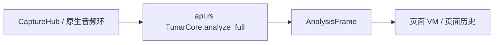
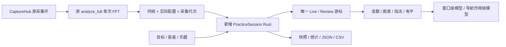

# 练音工作区施工手册

基线：`3325017` / master，开工时工作区干净。范围为 `practice-workspace.md` 的 P1/P2 与
A1–A12：三端功能、共享 Rust 会话、桌面任务布局。P3 仍为候选，不属于本次实现。
不启动 goal。图谱没有本仓库索引，已按精确文件和符号直接查读源码。

## 1. 基线与实现

开工基线树（省略生成绑定、资源和未变模块）：

```text
core/src/{api.rs,signal.rs,lib.rs}             # 单帧分析，无测量会话
ios/Tunar/Audio/AudioCapture.swift             # CaptureHub → AnalysisWorker
ios/Tunar/{App/TunarApp.swift,Tuner/,Instrument/} # 页面 VM 消费帧
macos/TunarMac/App/{DesktopRootView,DesktopNavigation}.swift
macos/TunarMac/Views/Desktop{Tuner,Analysis,Instrument}View.swift
android/app/src/main/kotlin/com/liuchong/tunar/{audio/,ui/navigation/,ui/instrument/}
```



实现树（+ 新增，~ 修改）：

```text
~ core/{Cargo.toml,src/lib.rs,src/api.rs,src/signal.rs}
+ core/src/{practice.rs,measurement_file.rs,practice_tests.rs}
+ core/tests/practice_workflow.rs
~ ios/Tunar/Audio/AudioCapture.swift
+ ios/Tunar/Practice/{PracticeWorkspaceModel.swift,PracticeWorkspaceView.swift}
~ ios/Tunar/{App/TunarApp.swift,Tuner/TunerView.swift,Instrument/InstrumentView.swift}
~ macos/{project.yml,TunarMac/App/DesktopRootView.swift}
~ macos/TunarMac/Views/DesktopInstrumentView.swift
+ macos/TunarMac/Views/DesktopPracticeWorkspace.swift
+ ios/TunarTests/PracticeWorkspaceTests.swift
~ android/app/src/main/kotlin/com/liuchong/tunar/audio/{CaptureHub,PcmSource,AudioRecordSource}.kt
+ android/app/src/main/kotlin/com/liuchong/tunar/ui/practice/{PracticeWorkspaceViewModel,PracticeWorkspaceScreen}.kt
~ android/app/src/main/kotlin/com/liuchong/tunar/ui/{navigation/AppNav,instrument/InstrumentScreen,tuner/TunerScreen}.kt
+ android/app/src/test/kotlin/com/liuchong/tunar/ui/practice/PracticePresentationTest.kt
~ macos/TunarMac/TunarMac.entitlements（用户所选文件读写）
~ 三端生成绑定；中英文现行规格 / README / 路线图
+ integration_test/practice_workspace.md
+ scripts/verification/run-rust-timed.py
```



## 2. 精确接口和状态

新增 `practice.rs`。以下字段均为 UniFFI Record，JSON 同名 snake_case；数值必须有限，
错误返回 `PracticeError`，未持有音频回调锁。会话由窗口 / 导航模型拥有，core 不访问文件系统。

| 类型 | 字段与约束 |
|---|---|
| `PracticeConfig` | `a4_hz:f64=440`、`temperament:u8=12`、`target_step:Option<i32>`、`target_midi:Option<i32>`、`target_hz:Option<f64>`（三者最多一个）、`target_name:String`、`instrument_id:String`、`variant_id:String`、`fingering_id:Option<i32>`、`tolerance_cents:f64=5`（2/5/10/20） |
| `PracticePoint` | `id:u64`、`segment_id:u32`、`config_id:u32`、`time_seconds:f64`、`frame:AnalysisFrame`、`target_hz:Option<f64>`、`cents:Option<f64>`、`target_name:String`、`reference_active:bool`、`valid:bool` |
| `PracticeTracePoint` | point 的 id/segment_id/config_id/time_seconds/cents、`input_dbfs:f32`、`valid:bool`；只传绘图标量 |
| `PracticeSegment` | `id:u32`、`config_id:u32`、`generation:u64`、`config:PracticeConfig` |
| `PracticeSnapshot` | `id:u32`、`name:String`（≤80字符）、`point:PracticePoint`、`config:PracticeConfig`；独立拷贝，最多8个 |
| `PracticeStatus` | `state:PracticeRecordingState`、`count:u32`、`review_id:Option<u64>`、`reason:String`、`payload_bytes:u64`、`snapshot_count:u32`、`baseline_id:Option<u32>`、`selection_start_id/selection_end_id:Option<u64>` |
| `PracticeSummary` | `segment_id:u32`、`start_time/end_time/valid_seconds/coverage:f64`、`median_cents/low_cents/high_cents/accuracy:Option<f64>`、`insufficient:bool` |
| `PracticeComparison` | `current/reference:Vec<f32>`（64/128桶按范围选择由 UI 展示）、`normalized:bool`；不兼容返回错误 |

`PracticeSession` 为 UniFFI Object，其 `Mutex<SessionCore>` 仅保护工作线程调用；`observe`
不是音频回调。API：

```rust
new() -> Arc<Self>
config() -> PracticeConfig
display_config() -> PracticeConfig
target_frequency() -> Option<f64>
configure(config: PracticeConfig) -> Result<(), PracticeError>
lock_reference(step: i32) -> Result<(), PracticeError>
lock_instrument(midi: i32, instrument_id: String, variant_id: String,
                fingering_id: Option<i32>) -> Result<(), PracticeError>
unlock_target(); start(); pause(); finish(); clear(); return_to_live()
observe(frame: AnalysisFrame, generation: u64, a4_hz: f64,
        temperament: u8, reference_active: bool) -> Result<PracticePoint, PracticeError>
status() -> PracticeStatus
display_point() -> Option<PracticePoint>
select_point(id: u64) -> Result<PracticePoint, PracticeError>
read_page(offset: u32, limit: u32) -> Vec<PracticePoint> // limit ≤64
trace_page(offset: u32, limit: u32) -> Vec<PracticeTracePoint> // limit ≤6000
live_trace() -> Vec<PracticeTracePoint> // 最近12秒，标量
add_snapshot(name: String) -> Result<PracticeSnapshot, PracticeError>
snapshots() -> Vec<PracticeSnapshot>
remove_snapshot(id: u32); set_baseline(id: Option<u32>) -> Result<(), PracticeError>
comparison(normalized: bool, wide: bool) -> Result<PracticeComparison, PracticeError>
summarize(start_id: u64, end_id: u64) -> Vec<PracticeSummary> // 同时保存规范化选区
export_json() -> Result<String, PracticeError>
import_json(contents: String) -> Result<(), PracticeError>
export_csv(start_id: Option<u64>, end_id: Option<u64>) -> Result<String, PracticeError>
```

内部 `SessionCore` 持有 latest_config（未记录实时帧也保留原配置）、config、state、points、segments、snapshots、baseline_id、review_id、
latest、live_trace、last_capture、last_bucket、segment_id、next_id、payload_bytes、reason。
记录预分配6000点，10Hz按音频时间分桶；最多512点/12秒实时标量缓存不作为文件真值。
start/resume 与配置/代次/参考音变化均切段；引擎重启自动暂停，明确继续。时间由音频位置
差累计，间断至少0.1秒，不依赖平台时钟。无效 / Holding 断线，参考音排除统计。
32MiB文件上限、6000点、600秒先到者暂停，保留数据；配置 / 快照开销一起计入预算；另预留24KiB覆盖数组分隔符、最大配置转义和文件头。

`measurement_file.rs` 持有 `MeasurementFile`（schema_version=1、points、segments、snapshots、
baseline_id、review_id、current_config、selection）与严格校验。先完整解析验证再替换会话；JSON完整重开，CSV不含频谱。
数组长度为64/128/256/256、实际峰≤8；时间单调、ID唯一、引用存在、目标与音分一致。
统计对相邻有效点（≤0.25秒）按时间积分、线性容差交点计算准音率，精确线性分布分位数。

## 3. 文件级施工映射

| ID | 基线锚点 / 行 | 操作与调用方 | 验收 |
|---|---|---|---|
| C01 | 新建 practice.rs / measurement_file.rs | 按§2完整实现；api.rs 导出，lib.rs 注册；Cargo增加serde/serde_json；api.rs AnalysisFrame/TunarEvent/Partial及signal.rs SignalState加serde派生 | A1–A10 |
| C02 | AudioCapture.swift AnalysisWorker L165 / CaptureHub L240；CaptureHub.kt startLocked | 同分析锁内保存实际配置，发布带frame/config/generation的测量事件；旧events保持兼容；旧代次帧不接入新会话；环形槽/短读携带实际累计采样位置，后台保留订阅但停硬件 | A3/A5/A6/A12 |
| C03 | 新建 Apple Practice/ 两文件 | 工作队列调用core，主线程发布只读状态；不每帧跨FFI复制全会话。原生文件对话框写入并显示错误（提供者决定替换原子性）；共享图表、目标、快照、统计、选区、键盘、参考音状态 | A1–A12 |
| C04 | DesktopRootView.swift L3 / .id(selection) L35 | 窗口 StateObject 注入同一模型；调音/分析打开同工作区不同任务；乐器保留表格并加练音入口；其他侧栏暂停记录。新桌面布局不使用570pt假设，project.yml共享新增文件 | A3/A4/A11/A12 |
| C05 | TunarApp.swift RootTabView L17；TunerView / InstrumentView | 根持有共享模型；调音和乐器明确入口打开全屏练音，传入目标指法并可取消；切非采集tab暂停；主屏保持原布局 | A1/A3/A4/A12 |
| C06 | 新建 Android ui/practice/；AppNav NavHost L90 | 导航级模型，工作dispatcher调用core；SAF文件读写，持久错误状态，权限与前后台恢复；乐器点击“设为目标”保留预览原义 | A1–A12 |
| C07 | 新建三层测试；现有测试复用 | 单元覆盖状态/数学/边界；Rust集成连接真实DSP→会话→文件；Apple/Android测试模型与布局，原生E2E独立手动清单 | 全部 |
| C08 | scripts/build-core-* / 生成绑定 | 全实现后统一构建并重新生成绑定，保留原工具链；三端库/接口一致 | A3/A10/A12 |
| C09 | docs 中英规格、README、roadmap、integration_test | 实现之前把提案状态改为施工中、旧非目标改为测量能力（仍无PCM录音）；最后依据证据分别更新实现与验收 | 全部 |

Swift模型 `PracticeWorkspaceModel`：session、queue、points（标量）、point、status、snapshots、
summaries、comparison、error、task、reference播放器。`accept`在工作队列消费测量包；UI
操作也在同队列排序。文件codec/统计不在主线程执行。iOS/macOS复用同一文件。
Android `PracticeWorkspaceViewModel`：viewModelScope+单dispatcher串行，StateFlow同等字段；
`CaptureHub.measurements`不从UI线程重做分析。文件操作由SAF URI负责，core只接字符串。

## 4. 唯一阶段清单

- [x] S0 / A：设计及施工映射写齐；I1原抽象接口在本文精化。
- [x] S1 / B：全量测试和原生验收步骤写齐，禁止运行。
- [x] S2 / C：C01–C09全量实现、接线、文档与生成输入完成，禁止中途测试。
- [x] S3 / D：统一编译、生成绑定、分层测试、原生验收、差异检查、签名提交推送。

施工完成即勾，验收仍独立：

- [x] C01 Rust会话、数学、快照、文件与API。
- [x] C02 三端采集测量事件。
- [x] C03 Apple共享模型与工作区。
- [x] C04 桌面任务布局和导航注入。
- [x] C05 iOS入口、指法目标与生命周期。
- [x] C06 Android共享模型、界面、文件与导航。
- [x] C07 全部测试源与原生步骤（写完后勾，运行另记）。
- [x] C08 最终生成绑定与三端库。
- [x] C09 双语规格与交付记录。

## 5. 测试与逐条验收

验收编号沿用 `practice-workspace.md` A1–A12，具体输入/预期不变。单元：
`core/src/practice_tests.rs`，状态、分桶、分段、锁定、数学分位数、快照及恶意文件；集成：
`core/tests/practice_workflow.rs`，真实合成PCM经TunarEngine进入会话并重开/导出；Apple
`PracticeWorkspaceTests`与Android `PracticePresentationTest`验证显示状态和导航边界。
原生E2E步骤保存在 `integration_test/practice_workspace.md`，不以单测替代麦克风/文件对话框。

先用 `run-rust-timed.py` 逐例运行并记录单调时间和状态，复用构建产物；XCTest使用xcresult，
Android使用JUnit XML。重型命令按controlled-run单跑起步，日志留 `docs/verification/practice-workspace/`
的本机忽略目录，提交的验收总结不含绝对路径或会话原文。最后统一fmt/clippy、Rust、
Android测试/构建/lint、Apple构建与可运行测试，再人工核验A1–A12，保留环境缺口。

自动与本机原生验收见[报告](verification/practice-workspace/report.md)。原设计复合A项包含真机和辅助功能环境，尚无完整证据的部分保持未勾选。任何中断从本清单下一项接续，不重启设计轮次。

最终结果：327项自动测试通过，原生桌面/Android模拟器证据与环境缺口见[验收报告](verification/practice-workspace/report.md)。签名与推送状态以Git提交及远端为准。
