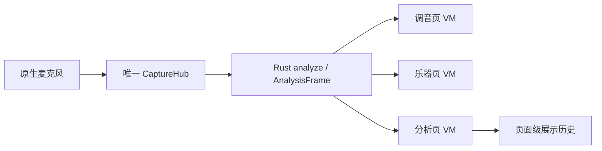
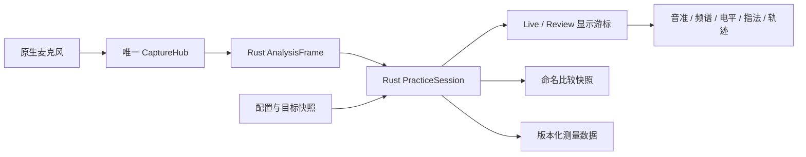

# 练音、测量回看与桌面工作区设计

状态：**P1/P2 已实现，自动测试与本机原生验收完成**；真机与无障碍环境缺口见
[验收报告](verification/practice-workspace/report.md)。精确施工与唯一进度入口见
[施工手册](practice-implementation.md)。本次实现目标音锁定、测量会话、回看、比较、统计、
保存导出及桌面布局；仍不保存原始 PCM、不提供音频回放。P3 保持后续候选。

后续输入与响应提案见[真实环境输入设计](input-behavior.md)：环境门限、显示平滑、停吹保留与测量有效性分离。状态为设计，未修改本轮已实现参数。

## 1. 用户目标与取舍

围绕三个真实任务安排信息，而不是围绕图表种类堆叠页面：

- **调音**：一瞥知道哪个音、偏高还是偏低、差多少；无需学习专业分析。
- **练音**：选定一个音，持续吹奏，放下乐器后检查起音、持续段、尾音与音量变化。
- **分析**：比较两次发声的频谱和泛音，检查不同音区、指法或演奏条件的差异。

优先级：P1 目标音锁定、音分轨迹、测量回看与桌面布局；P2 参考快照比较、区间统计、
本地保存与导出；P3 指法变体、音程比例参考和参考音音色。P1/P2 是产品次序，不是本轮
实现或验收批次。暂不扩展成录音棚、伴奏播放器、乐谱编辑器或乐器制造模拟器。

## 2. 设计前基线与差异

基线提交 `fa20d55`，以下保留设计前的源代码事实，不代表实现后的当前状态。代码图谱工具未连接，按精确
文件和符号直接查读；未据此作全仓库穷尽性结论。

| 现有入口 / 符号 | 当前责任 | 设计差异 |
|---|---|---|
| `core/src/api.rs:336`，`AnalysisFrame` | 单帧音高、频谱、包络、样本位置、信号状态 | 复用原始帧；新增会话与配置快照，不另开分析链 |
| `core/src/api.rs:817`，`analyze_full` | 一次分析产生各视图数据 | 增加记录消费者，不增加第二次 FFT |
| `ios/Tunar/Tuner/SpectrumHistory.swift:4`，`SpectrumHistoryBuffer` | 页面展示历史、峰值、冻结 | 保留为展示缓存；不能冒充可保存的测量会话 |
| 同文件 `acceptPitch` | 最近约 12 秒的 MIDI 音级轨迹；调用端传入整数 `midi` | 音分轨迹改用可信 `freq_hz` 对明确目标计算，不能用整数音级还原细小偏差 |
| `ios/Tunar/Instrument/InstrumentViewModel.swift:521`，`updateWindTarget` | 按最近指法音计算音分 | 点选图示预览与锁定调音目标必须分开 |
| `android/app/src/main/kotlin/com/liuchong/tunar/ui/instrument/InstrumentViewModel.kt:520`，`applyWindReading` | 主表 / 详情最近音高亮 | 共享 core 的目标判定，不在两端各加业务规则 |
| `macos/TunarMac/App/DesktopRootView.swift:3`，`DesktopRootView` | 六项侧栏；详情随 selection 重建 | 会话放在窗口级所有者，切页不丢记录或比较基准 |
| `macos/TunarMac/Views/DesktopAnalysisView.swift:14` | 页面持有历史，摘要读取当前 VM | 历史游标选中后，所有测量面板读取同一历史帧 |
| `core/src/reference.rs:26`，`list` | 当前 A4 与平均律的参考音列表 | 保持当前能力；音色与音程参考另行扩展 |

设计前关系：



已实现关系：



## 3. 目标音：预览、自动识别和锁定

三个状态必须独立：`preview_fingering_id` 只控制图示；`detected_pitch` 表示实测；
`target` 决定音分零点。现有点击指法预览保持原义，新增明确的「设为练习目标」操作；
不得静默把所有点选变成锁定。锁定后图示说明目标指法，实测命中仍以独立标识显示。

- `Auto`：按当前律制寻找最近音，显示自动识别标记。
- `Locked`：目标来自 core 参考音或乐器音，显示锁图标、音名、目标 Hz 和「取消锁定」。
- 统一计算 `1200 * log2(measured_hz / target_hz)`；偏差不折叠回最近半音、不自动折叠八度。
  超出表盘量程时指针贴边并显示方向箭头，数值仍显示真实偏差。
- 练音显示默认 ±50 cents，可选 ±100 cents；容差独立，默认仍为 ±5 cents，可选 2/5/10/20。
  统计使用容差快照；不能靠增大容差改写旧记录。
- 非 12 平均律以目标步序及目标 Hz 为准，不强制映射成十二平均律音名。
- A4、律制、目标或乐器型号改变时，新建配置段；历史使用当时目标和配置，不受当前设置污染。
- Quiet / Acquiring / Holding 不生成有效练音点。保持读数可供看表，但明确「保持」，
  不计入持续时长、准音率或稳定性。

## 4. 测量会话与回看

### 4.1 状态与操作

窗口会话包含记录状态 `Idle / Recording / Paused / Complete`，显示状态 `Live / Review`。
「记录测量」启动显式会话；「暂停记录」停止追加但不停止现有麦克风；「停止记录」进入
Complete 并保留结果。冻结当前图表、暂停记录、停止麦克风必须使用不同的命令与文案。

拖动历史游标进入 Review，并自动暂停记录，避免回看期间结果被覆盖；明确「回到实时」只
退出 Review，不自动恢复记录。继续记录须另按按钮。切换调音、乐器、分析保留会话与游标。
切到节拍器、小工具、设置时暂停记录、释放练音采集引用，返回仍需显式继续；不增加隐藏采集。
窗口失活、系统中断或设备重建时暂停记录、停止参考音并结束当前采样段；恢复时新增段。

- 桌面：空格暂停 / 继续记录；左右方向键逐样本移动，Shift + 方向键跨 1 秒；
  文本输入、弹窗或系统快捷键占焦点时不截获。
- 触屏：拖动时间轴、上一点 / 下一点、回到实时，触控目标至少 48dp/pt。
- 清空测量与重置峰值是两件事；前者显示影响范围，不能顺带删除命名快照或已保存文件。

### 4.2 数据内容、时间和容量

测量不是音频录制，不保存原始 PCM，不能生成可听回放。每点保存同一次 `AnalysisFrame` 的：
采样位置、实际采样率、信号状态、是否保持、可信频率、clarity、输入 dBFS、目标 / 配置段 ID、
64/128 桶频谱、频率范围、256 列波形包络、实际峰与和弦。缺失测量保留空值和原因。

默认最多每秒保留 10 个完整帧，按音频样本时间分桶，保留实际时间戳，不伪造整齐时刻。
单次会话上限 10 分钟或 6000 点或 32MiB 序列化有效载荷，先到者暂停并提示；不静默覆盖。
704 个 float32 数组值 × 6000 点约 16.1MiB，另有元数据；这是预算估算，后续实现须测量
进程实际峰值内存。生产存储预分配上限，跨 FFI 分页读取，禁止每帧复制整个会话。

引擎重启后 `sample_position` 可能归零：每段带独立 `capture_generation` 与 `segment_id`，
段内时间用 sample_position / sample_rate_hz。跨段用显式间断连接，不能画成无中断长音。
配置变更、丢帧、记录暂停、参考音启停也标记事件，选区不能跨事件盲算同一目标统计。

Review 的音名、Hz、音分、电平、指法、频谱与峰值必须来自**同一个选中点**；上方状态显示
「回看 00:12.4」。实时输入指示若保留，单独标「当前输入」，不得混到历史读数里。

### 4.3 保存与导出

P2 采用版本化 UTF-8 JSON 测量文件；包含 schema_version、配置段、原始测量点、快照与选区，
不含音频。Rust 负责格式解析 / 校验，原生层负责文件选择与写入错误反馈；先编码完整内容，替换原子性由系统文件提供者决定。未知版本、截断、
非有限数字、超容量数组或无效引用拒绝导入并保留当前会话；不猜测修复。

CSV 导出全会话或选区：segment_id、time_seconds、state、is_held、freq_hz、target_hz、
cents、input_dbfs、clarity、config_id、reference_tone_active。缺失值为空，不填 0；
表格公式前缀的自由文本要转义。JSON 可完整重开，CSV 仅用于数据分析，不能承诺重建频谱。

## 5. 长音与选区统计

同一目标下以 Hz 的完整精度计算音分曲线，默认显示最近 12 秒，可缩放到会话全长。横轴秒，
纵轴 cents，零线及容差带始终可见；Quiet / Acquiring / Holding 和跨段处断开。指针保持
不能画成持续发声。输入电平用独立 dBFS 轴或对齐子图，不与音分共用量纲。

用户拖选同一配置段的区间后，Rust 返回有效覆盖时长、音分中位数、P10–P90 范围、
容差内时长占比和有效数据覆盖率；按音频时间加权，不按帧数加权。有效区间仅取相邻可信
点且时间差不超过 0.25 秒的跨度；无效点截断跨度，暂停和缺口不补值。准音时间按线性
插值后的容差带交点计算。准音率的分母为有效覆盖时长，覆盖率的分母为所选区间时长，
二者并列，不能把缺失数据隐藏在高准音率里。P10/P90 与中位数使用相同时间权重。

少于 1 秒有效覆盖或少于 5 个可信点时显示「数据不足」。跨目标 / 配置选区展示分段结果，
不合成总音分中位数。起音和尾音由选区观察，不默认剔除；颤音不自动判为技巧错误。
参考音发声期间加标识，默认从演奏统计排除，防止把扬声器被麦克风采到当作演奏成绩。

## 6. 频谱、波形快照与比较

P2 支持从可信实时帧或 Review 点保存命名快照（最多 8 个）；一键「设为比较基准」。
主图最多叠加一个基准，使用线型和文字区分「当前 / 基准」，可显示 / 隐藏，不用颜色独立编码。
「峰值保持」仍是逐桶最大值，不等于某一次实际发声，不能默认作为可复现比较基准。

- 默认同一 dBFS 绝对刻度；可选「相对峰值归一化」，明确移除了总体电平差异。
- 快照记录乐器、目标、A4、采样率、FFT / 桶轴定义、频率上下限、输入条件备注和原时间。
  设置不同则标「条件不同」；频率网格不兼容时阻止直接叠加，不作无标识重采样。
- 泛音比较显示实际检出峰的 Hz、幅值与 Hn；没有检出的峰留空，不按整数倍补造。
  64/128 展示桶不能宣称具备原始 FFT 峰值的频率精度；游标插值不增加测量分辨率。
- 波形只是当前窗口的最小 / 最大包络。无相位对齐证据时并列比较，不把形状差异直接
  解释成音色优劣；麦克风、距离和增益不同也不能给出乐器品质结论。

P3 可讨论线性频轴、局部频段和音程比例标记。前两项须由 core 从同一次 FFT 的原始线性
频点生成，不能对现有对数桶改标签冒充新频谱；比例标记必须显式选择根音与比值集合，
不把几个参考点称为完整的新律制。噪声频段排除只作为可见、可关闭的高级实验项，需有
漏检与八度误判证据后才进入实现，不能静默滤掉目标基频。

## 7. 桌面布局与视觉重心

保留六项侧栏。调音与乐器入口打开同一个窗口级测量工作区的不同上下文；工作区顶部提供
「调音 / 练音 / 分析」任务切换。既有专业分析侧栏进入分析任务。导航是上下文切换，
不创建第二个会话、第二条音频链或额外窗口。节拍器、小工具、设置仍为独立任务。

| 任务 | 最大视觉区域 | 始终可见 | 按需展开 |
|---|---|---|---|
| 调音 | 单指针 + 大音名 + 有符号音分 | 自动 / 锁定、目标 Hz、保持状态、输入电平 | 频谱、详细指法、会话 |
| 练音 | 音准读数 + 目标音分轨迹 | 目标指法、记录状态、时间轴、参考音开关 | 长区间统计、完整指法表、频谱 |
| 分析 | 频谱 / 波形比较 | 游标读数、当前 / 基准、范围、状态 | 瀑布图、全部峰值表 |

练音宽屏布局（示意，不是像素截图）：

```text
┌────────┬─────────────────────────────────────────────────┐
│ 侧栏   │ 任务切换     洞箫 G / 8孔    A4=440    12-TET   │
│        ├──────────────────────────────┬──────────────────┤
│ 调音   │ 音名 G4   +3.2 cents         │ 目标 G4 · 已锁定 │
│ 乐器   │ 单指针 / 偏高 / 392.7 Hz     │ 一支完整乐器图   │
│ 分析   │                            │ 当前目标指法     │
│ …      ├──────────────────────────────┤ 预览 ≠ 锁定     │
│        │ 目标音分轨迹 + 对齐电平       │ 参考音 开/关     │
│        ├──────────────────────────────┴──────────────────┤
│        │ 记录状态  暂停记录  时间轴 / 历史游标  回到实时 │
└────────┴─────────────────────────────────────────────────┘
```

- 以内容区宽度计算：≥1040pt 主区域与 280–320pt 目标检查器并排；720–1039pt 检查器收成
  紧凑目标行，完整指法从抽屉打开；<720pt 单列，优先音准、记录、轨迹，频谱折叠。
- 低于 760pt 高度时压缩表盘装饰和页头，不能把读数或记录控制挤出可见区；窗口缩放不清
  会话。侧栏可由用户收起，内容区断点不能误用整个窗口宽度。
- 桌面取消主调音页固定 570pt 的布局假设；优先保证音名 64–88pt、音分 28–36pt 与
  读数 / 指针不重叠。指法图保持完整，详细表转抽屉，不把整张大表挤入每个任务。
- 调音时音准为第一重心，练音时轨迹为第二重心，分析时频谱为第一重心；不在所有任务
  同时铺开瀑布图、峰值表、和弦、波形和全部指法。
- 常用 A4、目标、容差靠近读数；低频设置放检查器。沿用 Aurora 语义色、单针、等宽数字、
  减少动态效果偏好。电平显示 dBFS，削波与低输入用明确文字，不标未经校准的声压级。
- 手机复用会话与业务规则，主屏仍保留原布局；回看用全屏页，比较和统计用抽屉。

## 8. 指法与参考音扩展

P3 指法按实际音高与指法变体分离：乐器族、尺寸 / 调性、孔制、流派、音区、传统音名、
孔位、俯仰提示和替代变体分别存储。仅在有可靠数据时展示流派选择；没有变体不画单选
下拉框。不得通过改名称或八度平移制造缺失指法，也不从实测音高推断实际用了哪个指法。

参考音增加独立音量与正弦 / 柔和泛音两种音色候选；音高表和波形样本生成统一由 Rust
拥有，原生侧仅播放。保持当前默认音色，加入无爆音切换、输出失败、扬声器回采标记和
中断停止的验收；不能把参考音或节拍器漏入麦克风的声音计作练音成功。

## 9. 后续模块与接口边界

以下模块已实现。精确导出方法与字段见[施工手册 §2](practice-implementation.md#2-精确接口和状态)，
`spec-core.md` 与生成绑定已同步；表内名称以实际实现为准。

| 模块 / 类型 | 已实现责任与入口 |
|---|---|
| `core/src/practice.rs`，`PracticeSession` | 目标解析、记录状态机、有界存储、选区统计；`configure`、`lock_reference`、`lock_instrument`、`start`、`pause`、`finish`、`observe`、`read_page`、`summarize` |
| `core/src/measurement_file.rs` | 版本化 JSON / CSV 编解码与容量校验，禁止平台文件 API |
| `PracticePoint` | `id: u64`、`segment_id: u32`、`config_id: u32`、`time_seconds: f64`（采样位置/采样率在 frame 内）、`frame: AnalysisFrame`、`target_hz: Option<f64>`、`reference_active: bool` |
| `PracticeConfig` / `PracticeSegment` | A4、律制、目标模式 / 步序 / Hz、乐器 / 型号 / 变体、容差、采集代次和轴定义；历史不可变 |
| `PracticeSnapshot` | 独立保存所选帧与配置，即使清空会话仍可用；不引用环形缓冲地址 |
| Apple 窗口级 `PracticeWorkspaceModel` | 只经 UniFFI 调用 core；拥有会话句柄、显示游标、布局与文件对话框；切页注入同一实例 |
| Android `PracticeWorkspaceViewModel` | 导航作用域内同一会话；接收共享采集流，权限与生命周期仍由原生负责 |

实现树：在现有 `core/src/` 增加上述两个模块及 API 导出；在 Apple 共享源码与 Android
`ui/` 增加练音工作区模型和面板；macOS `DesktopRootView` 注入同一工作区而非每页各建。
现有展示缓存继续服务短时实时图，不能成为测量存储或统计真值。实时回调仍只写预分配
环形缓冲；会话追加、文件编码、统计、FFI 分页都在分析 / 工作线程，不在音频回调执行。

## 10. 设计交付、施工与验收分离

设计交付：

- [x] 当前源码快照、业务差异、任务布局及状态边界。
- [x] 数据与内存边界、保存语义、责任划分与可观察验收项。
- [x] 中英双语设计入口及后续里程碑。

实现清单：

- [x] I1 按本文补齐精确方法签名、逐文件施工片段与全部测试用例，再统一实现。
- [x] I2 core 目标解析、会话记录、统计、快照、版本化文件及 UniFFI。
- [x] I3 三端共享会话接线、桌面任务布局与移动回看。
- [ ] I4 指法变体、参考音色等后续扩展按各自范围设计并实现。

完整环境验收清单：下列复合项只有全部平台与环境均有证据才勾选。
自动测试和已执行的桌面/模拟器结果见[逐项记录](../integration_test/practice_workspace.md)；
未勾选不表示功能未实现。

- [ ] A1 锁定 D4 输入逐渐偏至 D#4 及 D5，目标不跳；数值不折叠，指针越界可辨。
- [ ] A2 同音级 +3 / -7 cents 的合成输入产生不同轨迹；静音 / Holding 为断点，非长音。
- [ ] A3 记录后在三个任务与侧栏间切换，会话 / 游标 / 快照保持，只有一路采集与一次 FFT。
- [ ] A4 空格、方向键、触屏游标正确；输入框焦点不截键；暂停与返回实时不暗中恢复记录。
- [ ] A5 任意回看点的所有读数与图表都来自同一帧；历史 A4 与目标不受当前设置改变影响。
- [ ] A6 重启引擎、变采样率、中断、失活、暂停、丢帧均分段；不绘制虚假连续线。
- [ ] A7 达到任一容量上限停止追加并保留结果；记录 / 分页 / 编码的实际内存可测且有界。
- [ ] A8 准音率按有效时间计算；无效点、参考音、跨目标选区、数据不足都有明确结果。
- [ ] A9 快照重开可比较；清峰值 / 清会话不误删基准；条件不同标识，网格不同拒绝叠加。
- [ ] A10 JSON 保存再打开等价；CSV 空值正确；截断、未知版本、超限、非法数字不破坏现会话。
- [ ] A11 内容区宽 640/900/1200pt、高 600/800pt，浅 / 深色、大字与减少动态效果下可操作，
  音名不压指针、目标图完整、记录控制可见；原生真机 / 桌面截图逐项验收。
- [ ] A12 参考音泄漏不计成绩；权限拒绝、输入失败、文件写入失败和后台返回保留清晰状态。

P1/P2 的实现与可运行环境验收已交付；I4/P3 不属于本轮范围。真机、系统中断和
辅助功能组合仍保留待验状态，不以桌面或合成输入结果代替。
