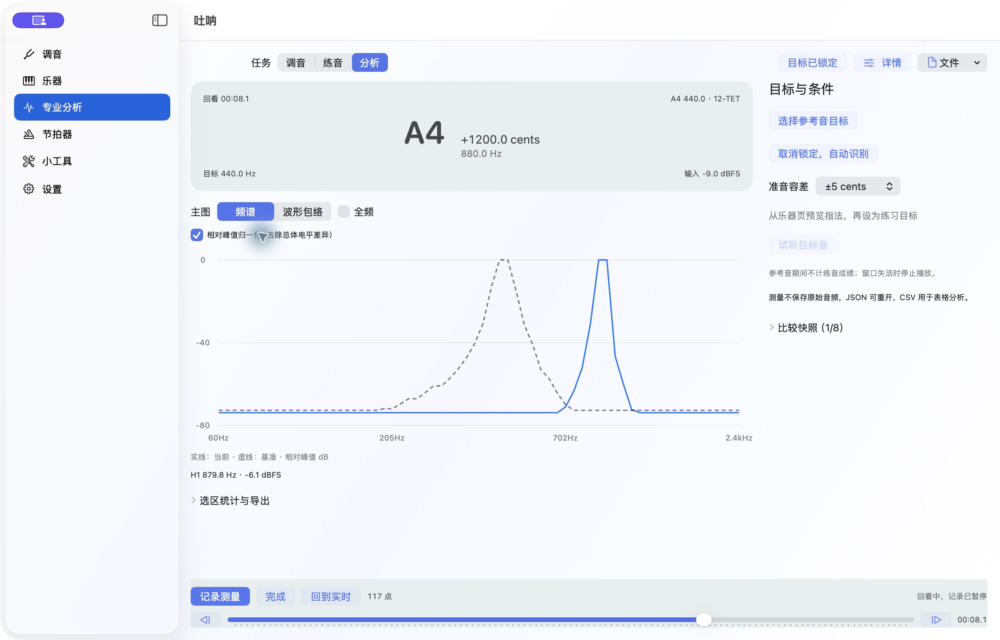
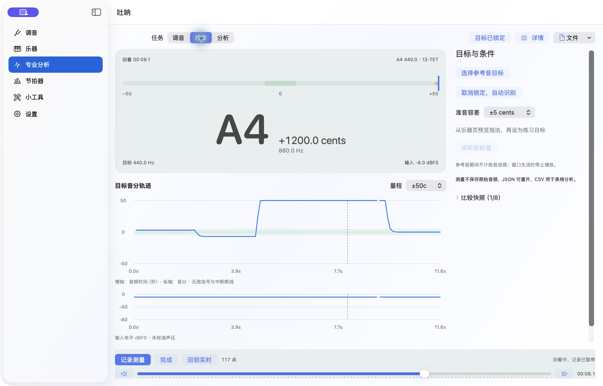
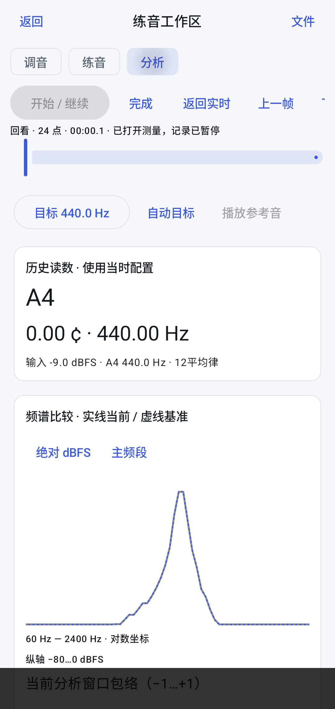
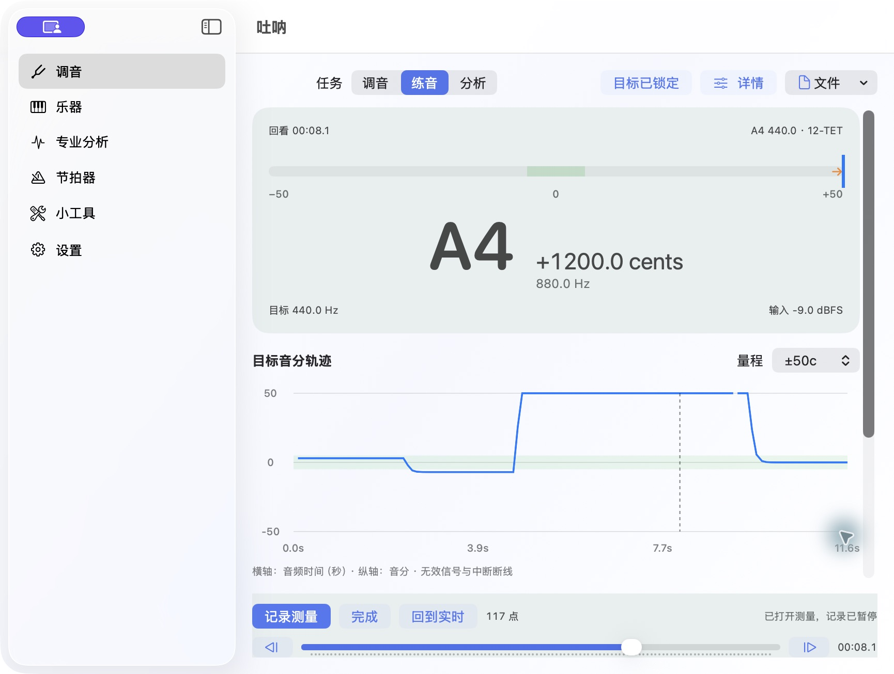

# 练音工作区验收报告

日期：2026-10-23。基线：`3325017`；验证对象为本报告所在提交的最终实现。
先写齐设计、全部用例和实现，再集中构建、测试、修复回归及原生验收。
P1/P2 已实现；P3 指法流派、参考音色与音程比例仍为后续候选。

## 交付行为

- Rust 会话统一目标锁定、真实音分、记录/暂停/回看、配置分段、选区统计、独立快照和 JSON/CSV；10Hz、6000点、600秒、32MiB先到即暂停，保留结果。
- 三端接入同一会话合同。历史点保留原 A4、目标、采样位置、频谱和包络；返回实时不会继续记录。参考输出与余响保护帧不计成绩。
- 桌面调音突出音名与单针；练音突出音分/电平轨迹；分析突出当前/基准频谱。宽窗并排检查器，窄窗详情抽屉，底部记录控制固定。原有专业工具仍可打开。
- Apple 原生文件面板、Android SAF 接入完整测量 JSON 与全部/选区 CSV。失败显示可恢复信息。仅保存测量，无 PCM 录音或音频回放。

## 自动验证

逐例名称、状态、耗时见 [test-results.json](test-results.json)。最终共 **327 项通过，0 失败、0 跳过**。

| 层级 | 通过 | 边界 |
|---|---:|---|
| Rust 单元 | 135 | 状态、数学、目标、容量、严格文件校验；含已有核心回归 |
| Rust 集成 | 9 | 真实合成 PCM → DSP → 会话 → JSON/CSV，含 +3/-7/+100/+1200 cents、A4=442 |
| iOS XCTest | 72 | 模拟器，真实绑定/模型、后台帧主线程发布、会话与采集门控等 |
| macOS XCTest | 22 | Apple Silicon，布局断点、采集门控和共享会话模型 |
| Android JVM | 83 | 展示、配置、采集错误/重试/元数据及已有页面回归 |
| Android 原生集成 | 6 | API 36 模拟器，真实 JNI/DSP、文件/Compose 回看、实际导航入口与目标保留，含已有指法语义用例 |

`cargo fmt --check`、全目标 clippy（warnings=errors）、doctest、Android debug 构建/lint、
iOS 模拟器测试及无签名真机构建、macOS ARM 测试和 Intel 构建均通过。
Swift/Kotlin 绑定由脚本生成；Apple 各 slice 和 Android 三种 ABI 库同步重建。
Android 本地库改为生成产物，首次构建须先执行核心构建脚本，避免陈旧 ABI 混用。

Rust 按单例进程记录单调墙钟时间；XCTest/JUnit 使用框架耗时，编译与准备单独计。
三者不作性能横比，没有历史基准，不声称性能提升。构建、测试和自编译应用在受控进程树中运行并回收。

## 原生验收证据

macOS 用 Rust 真实 DSP 生成的117点夹具检查同帧回看：目标440Hz，输入880Hz时保留
+1200.0 cents并显示越界；历史末段 A4=442，回到前段仍为440。分析频谱显示当前880Hz
与虚线440Hz基准，归一化轴为相对 dB。

通过系统文件面板保存完整 JSON 和选区 CSV。保存结果与源文件的117个点逐一比较，
ID、采样位置、时间和音分一致；基准及选区保留。选区3–19导出17行，时间逐行一致；
统计为有效1.60秒、覆盖率100%、准音率100%、中位/P10/P90均+3.0 cents。

逐项结果及剩余条件见 [A1–A12矩阵](../../../integration_test/practice_workspace.md)。截图为运行中的原生界面，不作为未执行硬件场景的证据。

桌面最终构建还实际验证：保存文件再次打开后117点/基准/选区保留；连续8次方向键从
游标81准确到89；损坏JSON显示错误并保留117点；清空后0点且仍有1个命名快照。
窄窗详情抽屉可打开；低高度窗口仍可见固定记录控制和滚动内容，重新导入保留会话。

## 统一验收中修复的问题

- Swift 6 后台分析事件继承主 actor 导致崩溃：显式 Sendable 接收，工作队列处理，主线程发布；后台事件回归通过。
- macOS 文件面板缺少用户选择文件读写 entitlement：补齐并实际保存/打开验证。
- 实际音频时钟被丢窗或短读压缩、采集失败状态被启动完成覆盖、共享订阅导致重试无效：保留真实位置、原子状态和不丢订阅的重启。
- 旧配置、选区重开和参考输出尾帧：历史配置单独保存，选区恢复到统计/导出，输出停止后保守保护分析帧。
- 连续快捷键读到旧 UI 游标而丢步：游标在同一工作队列读取并移动，8次连续命令回归通过。
- 临界载荷未计数组分隔符/配置转义，重新打开后重置600秒预算：两项先复现失败，再修正并全量回归；达到上限仍可导出重开。

## 证据边界

本轮没有物理乐器与手机麦克风的完整验收，也未覆盖所有系统音频中断/设备热插拔、
所有 SAF 提供者的写入故障、完整深色/大字/减少动态效果组合。Intel Mac 和 iOS 真机只构建，
不计运行验收；容量停止/格式有自动用例，但未完成6000点全程的专项内存曲线采样。
桌面合成夹具、模拟器权限和生命周期测试不能代替这些场景；相应复合验收项保留未勾选。
